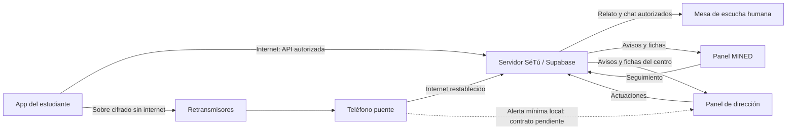

# SéTú — Especificación técnica del proyecto

**Bugñuelitos · Universidad Americana (UAM) · Nicaragua**
**Revisión:** 9 de noviembre de 2026. **APK existente:** 0.2.0+2 (M1).
**Estado:** definición y prototipado académico; arquitectura ampliada en diseño.

SéTú combina una aplicación para pedir apoyo de forma privada y una campaña permanente de sensibilización sobre salud mental. Se dirige a estudiantes de **3.º a 11.º grado**; la primera fase propuesta comprende colegios públicos del casco urbano de Managua. El MINED se plantea como primer intermediario institucional, una mesa de escucha humana atiende al estudiante y el colegio documenta actuaciones sin acceder al chat.

El proyecto participa en la **Jornada Académica y Social UAM - UNICEF 2026**, bajo la temática *Apoyo a la Salud Mental de Niñas, Niños y Adolescentes*. No es un producto oficial ni avalado por UNICEF, MINED o MINSA. Alianzas, financiación y operación con casos reales están pendientes de validación.

Este README es el documento principal de especificación técnica. Describe el producto, componentes, datos, funcionamiento sin internet, seguridad y condiciones de desarrollo. Los documentos enlazados amplían los contratos y diagramas.

## 1. Estado y autoridad de las decisiones

| Etiqueta | Significado |
| --- | --- |
| Implementado | Existe en el código; se explican límites y verificaciones disponibles. |
| Decisión del equipo | Dirección de producto registrada en Drive; no implica implementación. |
| Propuesta técnica | Alternativa para materializarla; requiere aprobación antes de programar. |
| Pendiente | Falta un acuerdo, validación o prueba que cambia el resultado. |

Las fuentes de producto están en el [Drive del equipo](https://drive.google.com/drive/folders/1BSIhalcR9OKPbfXwTDoexnr12lPAXE6c). Su revisión se registra en [docs/09](docs/09-revision-drive-y-trazabilidad.md). [ADR 0005](docs/decisiones/0005-alineacion-con-decisiones-del-equipo-drive.md) reemplaza el acceso por alias + PIN de ADR 0003. [ADR 0006](docs/decisiones/0006-especificacion-tecnica-y-mesh-propuesta.md) registra las propuestas técnicas de esta especificación **sin declararlas aprobadas**.

## 2. Problema, propósito y alcance

El equipo identifica temor a represalias, dificultad para expresar el malestar, estigma sobre la atención psicológica y desconfianza en la respuesta escolar. SéTú propone conectar solicitudes privadas con escucha profesional y seguimiento institucional. El impacto aún no está medido: la entrevista y los instrumentos de encuesta orientan el diseño, pero no prueban la eficacia del sistema.

El proyecto comprende cinco componentes:

1. **App estudiantil:** código escolar, solicitud de apoyo, seguimiento privado, chat humano y sección informativa.
2. **Atención y supervisión:** mesa de escucha y panel MINED para fichas, seguimiento y escalamiento.
3. **Panel de dirección:** avisos mínimos, fichas autorizadas, actuaciones y estadísticas del centro; sin chat.
4. **Modo sin internet:** transporte cifrado de alertas mediante teléfonos cercanos hasta un teléfono puente.
5. **Campaña presencial y digital:** contenidos para jóvenes y familias, y rutinas de aula de 5–10 minutos. Los docentes no usan la app.

### Objetivo de demostración del 17 de noviembre

Mostrar un **caso ficticio** viajando entre celular del estudiante, panel MINED y panel de dirección, incluido un tramo por red mesh sin internet. Demostrar entrega y separación de datos entre destinatarios. Cualquier tramo simulado se identifica en pantalla y ante el jurado.

El chat completo, el contenido multimedia y los reconocimientos institucionales forman parte de la visión; su inclusión en el corte ejecutable debe priorizarse y aprobarse. No se consideran funcionalidades terminadas.

### Límites

No hay reportes públicos, rankings, mensajería entre estudiantes, sanciones automáticas, diagnóstico, chatbot ni terapia automatizada. El nivel de alerta lo asigna una persona profesional. Las actividades no generan perfiles clínicos ni puntuaciones emocionales.

Adjuntos y evidencias aparecen en investigación y costos, pero no tienen contrato aprobado para el MVP. La propuesta inicial de mesh transporta alertas pequeñas, sin fotos, audio o video. Los contactos de ayuda necesitan verificación editorial antes de publicarse; esta especificación no certifica números ni horarios.

## 3. Personas, superficies y responsabilidades

| Participante | Función prevista | Acceso permitido |
| --- | --- | --- |
| Estudiante: víctima o Testigo Solidario | Pedir apoyo y consultar seguimiento | Sus casos y conversación visible mediante un acceso privado aún por definir. |
| Mesa de escucha | Conversar, valorar nivel y preparar derivación | Relato y chat de casos asignados; notas internas separadas. |
| Asesor MINED autorizado | Supervisar fichas y solicitar actuaciones | Avisos y fichas dentro de su ámbito; chat no concedido por defecto. |
| Dirección/enlace | Recibir avisos y documentar actuaciones | Alerta mínima, ficha autorizada y estadísticas de su colegio; nunca chat. |
| Retransmisor | Guardar y reenviar sobres cifrados | Metadatos mínimos de transporte y ciphertext; sin contenido legible. |
| Teléfono puente | Recibir sobres, entregar al destino local y sincronizar | No obtiene acceso al relato por actuar como puente. |
| Operación técnica | Mantener dispositivos y plataforma | Configuración y salud técnica; sin contenido por defecto. |
| Docentes y familias | Campaña y apoyo presencial | Material editorial; el vínculo no concede acceso a casos. |

La mesa de escucha es una función dentro del sistema de atención; no obliga a crear una cuarta aplicación. Drive plantea psicólogos de planta, articulación con MINSA y practicantes de Psicología de 5.º año. Convenios, acreditación, supervisión de practicantes, horarios y disponibilidad siguen pendientes.

## 4. Recorrido funcional

1. El estudiante conoce los límites de privacidad y atención. Puede consultar ayuda o contenidos sin reportar.
2. Escanea el QR público o introduce el código del colegio y confirma el centro. No crea cuenta, alias ni perfil y no se exige identidad civil.
3. Selecciona **tipo de situación**, **rol** y **detalles opcionales**; revisa y corrige antes de enviar.
4. La app protege la operación localmente y muestra el estado real de transporte.
5. Con internet, el servidor registra una sola recepción y entrega avisos mínimos al MINED y al colegio. El relato se reserva al circuito de escucha.
6. Sin internet, se intenta llevar el sobre hasta el puente mediante dispositivos cercanos. Recepción local y recepción central se distinguen.
7. La mesa de escucha conversa cuando está disponible. Las tarjetas rompehielos facilitan escribir. El filtro de vocabulario no decide riesgo ni debe impedir pedir ayuda.
8. El profesional decide acompañamiento, ficha de convivencia o derivación por riesgo grave. Dirección documenta actuaciones sobre la ficha permitida.
9. El estudiante consulta solo su respuesta y estado visibles; cierre y escalamiento quedan registrados por personal autorizado.

**Sin cuentas visibles no significa acceso compartido a casos.** El código público identifica al centro, no al dueño del reporte. Hay que aprobar continuidad privada, pérdida de dispositivo y uso compartido. Alternativas en [arquitectura](docs/02-arquitectura.md).

Drive contempla geolocalización al escanear el QR. Permisos, rechazo, ausencia de señal, uso fuera del colegio e ingreso inicial sin internet están abiertos. La ubicación precisa no se guarda. QR + GPS no demuestra por sí solo matrícula ni identidad.

## 5. Arquitectura lógica objetivo

**Stack confirmado:** Flutter/Dart para Android y Supabase/PostgreSQL como backend objetivo. Implementación de paneles, transporte mesh y autenticación permanecen en diseño.



Las flechas representan destinos lógicos, no acceso a tablas completas. La rama local punteada figura en Drive; contenido, claves y autenticación deben aprobarse antes de implementarla.

| Componente | Función | Estado |
| --- | --- | --- |
| App Flutter y `go_router` | APK Android y navegación | Base implementada; nuevo recorrido pendiente. |
| Almacén AES-GCM-256 | Proteger datos ficticios al reiniciar | Implementado M1; adaptación como cola pendiente. |
| API de aplicación | Validación, recepción idempotente y permisos | Propuesta; sin backend conectado. |
| PostgreSQL y RLS | Aislamiento por institución y recurso | Objetivo confirmado; esquema/políticas no implementados. |
| Paneles y mesa | Atención y seguimiento diferenciado | Diseñados; no implementados. |
| Transporte de proximidad | Conectar vecinos y transferir sobres | Nearby Connections es candidato, sin selección ni prueba. |
| Protocolo de reenvío | Colas, caducidad, deduplicación y acuses | Propuesta técnica. |
| Enlace local puente–dirección | Recepción escolar sin internet | Pendiente; una web alojada en internet no basta. |

No se crean microservicios, cuentas, despliegues o dependencias por describir esta arquitectura. Cloudflare Pages y FCM aparecen en costos como opciones; no son integraciones existentes.

## 6. Datos y límites de confianza

| Información | Destino permitido | Exclusiones |
| --- | --- | --- |
| Código público escolar | App y validación de centro | No consulta expedientes ni administra. |
| Código privado institucional | Validación/canje de acceso de dirección | No se publica en QR estudiantil, Git ni logs. |
| Alerta mínima: tipo, rol y hora | MINED y dirección autorizados | Sin relato, chat, capturas o identidad civil. Estos metadatos también son sensibles. |
| Relato opcional y chat | Circuito de escucha autorizado | Nunca dirección ni retransmisores en claro. |
| Nivel y ficha de actuación | MINED y colegio correspondiente, salvo conflicto | Datos necesarios, sin copiar el chat. |
| Actuaciones | Supervisión y seguimiento autorizados | Respuesta al estudiante como proyección distinta. |
| Notas internas | Equipo asignado según facultades | Fuera del modelo estudiantil. |
| Sobre cifrado | Retransmisores y puente | Sin sesiones, credenciales o claves privadas del emisor. |
| Auditoría | Supervisión de seguridad | Sin cuerpos del caso, códigos privados ni tokens. |
| Estadísticas agregadas | Centro propio y ámbito MINED autorizado | Sin rankings públicos ni grupos pequeños identificables. |

El modelo propuesto separa instituciones, accesos institucionales, capacidades privadas de caso, reportes, mensajes, notas, fichas, actuaciones, eventos, sobres, acuses y contenidos. Ver [docs/02](docs/02-arquitectura.md). No es un esquema listo para migrar.

### Recepción e idempotencia propuestas

Cada operación tiene un identificador aleatorio persistido y una huella del contenido. Un reintento devuelve el mismo recibo sin duplicar el caso; reutilizar el identificador con otro contenido se rechaza. El servidor verifica la prueba del emisor o capacidad privada del caso, **no atribuye el reporte al usuario del puente**.

La confirmación central se emite después de persistir la recepción. Si se pierde, se consulta o reintenta con la misma operación. Un acuse de puente acredita custodia o recepción local, no lectura profesional ni recepción del MINED.

## 7. Red mesh y funcionamiento sin internet

**Decisión del equipo:** la alerta viaja cifrada entre celulares hasta un teléfono puente. **Propuesta técnica:** almacenamiento y reenvío oportunista; un dispositivo conserva sobres y los transfiere cuando encuentra un vecino apto, sin exigir todos los eslabones conectados simultáneamente. La viabilidad física todavía no está probada.

Sin internet se necesitan app compatible, permisos, radios Bluetooth/Wi-Fi según el transporte, batería y encuentros dentro del alcance real. Sin vecinos o puente accesible, el reporte permanece pendiente. No se promete cobertura de todo el colegio ni entrega inmediata.

### Ruta prevista

1. La app dispone de configuración y claves públicas auténticas antes de quedar sin conexión. El primer ingreso totalmente desconectado requiere resolver aprovisionamiento confiable.
2. Genera la operación, cifra para sus destinatarios y guarda la cola protegida.
3. Busca vecinos y transfiere el sobre. El retransmisor no interpreta la situación ni lee el relato.
4. Cada receptor valida formato, tamaño, caducidad y duplicados y guarda antes de confirmar custodia.
5. El puente conserva el sobre y, con un contrato local aprobado, lo entrega al receptor institucional. Puente y dirección son funciones distintas aunque compartan equipo de demo.
6. Con internet restablecido, sube el sobre; el servidor verifica emisor, centro, integridad y unicidad.
7. Un acuse central autenticado puede regresar por internet o por la red oportunista. Sin recibirlo, el emisor mantiene confirmación pendiente aunque el servidor ya tenga el caso.

### Cifrado y destinatarios

El cifrado local M1 y el cifrado del enlace inalámbrico no bastan para una cadena de intermediarios. Hace falta un **sobre cifrado de extremo a extremo hasta su destinatario autorizado**. Retransmisores y puente no tienen la clave para leer relato/chat. Si dirección debe leer una alerta mínima offline, necesita un destinatario y claves distintos de los del circuito de escucha.

No se incluye una clave común en todos los APK ni se usa el código del colegio como clave de cifrado. Distribución de claves públicas, rotación, revocación, autenticación de acuses y recuperación están pendientes. El cifrado no oculta por completo proximidad, horarios, tamaños y patrones de tráfico.

### Transporte candidato

[Nearby Connections](https://developers.google.com/nearby/connections/overview) permite conexiones cercanas sin internet usando Bluetooth/BLE/Wi-Fi; [Cluster](https://developers.google.com/nearby/connections/strategies) admite varios vecinos. Se propone evaluarlo. La conexión entre vecinos no sustituye el protocolo de retransmisión, deduplicación y acuses de SéTú.

Los [permisos necesarios](https://developers.google.com/nearby/connections/android/get-started) dependen de versión y transporte. Android aplica [restricciones en segundo plano](https://developer.android.com/develop/connectivity/bluetooth/ble/background). Primero se probarán equipos concretos con apps visibles; no se promete reenvío continuo con la app cerrada. Plugin Flutter o canal nativo, Google Play services, consumo y compatibilidad requieren prueba aprobada.

Ver [flujo de datos y red mesh](docs/10-flujo-datos-y-red-mesh.md) para sobres, estados, colas, retorno, sincronización y pruebas.

## 8. Protocolo humano y estados

| Nivel decidido por el equipo | Tratamiento previsto | Condición |
| --- | --- | --- |
| 1 · Acompañamiento | Escucha y orientación; puede resolverse en chat | No forzar ficha escolar. |
| 2 · Convivencia / acoso | Ficha y seguimiento MINED–colegio | Información mínima y destinatarios autorizados. |
| 3 · Riesgo grave | Derivación humana a enlaces de protección y salud | Responsables, contactos y protocolo por validar. |

Estados acordados: **Recibido, En escucha, Ficha enviada, Colegio actuando, Escalado y Cerrado**. No todos los casos deben recorrerlos todos: acompañamiento puede cerrar sin ficha y riesgo grave puede escalar antes de actuación escolar. Las transiciones excepcionales y sus permisos son propuestas en [arquitectura](docs/02-arquitectura.md).

*Pendiente sin conexión* es un estado de transporte, no un séptimo estado del caso. *Recibido* debe indicar ámbito local o central. Los indicadores de atención necesitan marcas de tiempo definidas; el reloj del emisor no es una autoridad confiable.

Drive plantea doble autorización, registro y aviso para revelación excepcional por protección de la vida. **No existe una identidad civil secreta que la app pueda desanonimizar.** Solo puede compartir información aportada o coordinar una solicitud de contacto según protocolo aprobado. No se convierte el GPS en identificación encubierta ni se promete confidencialidad sin límites.

## 9. Seguridad, privacidad y accesibilidad

- Autorización en servidor y base de datos; denegación por defecto y aislamiento institucional. Roles administrados por una vía confiable.
- Permisos separados para aviso, chat, ficha, nota y actuación. Acceder al panel MINED no concede todo el expediente.
- Sesiones y claves protegidas; códigos privados nunca en claro. Altas, bajas y sustitución de enlace auditables.
- Validación, cuotas y transiciones en servidor. Reintentos y recepciones simultáneas transaccionales.
- Cifrado local y de enlaces, además del sobre hasta su destinatario. No se declara E2EE integral ya implementado.
- Sin relatos en notificaciones, telemetría, auditoría o errores. Anuncios de proximidad sin nombres personales o del teléfono.
- Agregados revisados contra reidentificación. Reconocimientos no premian pocos reportes o cierres precipitados.
- Continuidad privada en teléfonos compartidos y recuperación después de borrar datos necesitan decisión explícita.
- Español sencillo, texto ampliable, lector de pantalla y estados con texto además de color. Comprensión adaptada a primaria y secundaria.

Los casos reales requieren [protección y operación](docs/03-proteccion-y-operacion.md): responsable institucional, atención humana, protocolo, revisión local del tratamiento de datos, retención, incidentes y ayuda verificada. Esta demo no habilita el servicio.

## 10. Identidad visual

Autoridad: [Manual de Marca final de Drive](https://drive.google.com/file/d/11vE2_hviWBnT79giw6Y8mgofxUckyae6/view), **32 páginas**, y [variantes SVG oficiales](https://drive.google.com/drive/folders/16XnURY24OzDCv9UqPX7VS9Bx4QxwfzsZ). El PDF del repositorio es inicial.

| Elemento | Especificación |
| --- | --- |
| Nombre | **SéTú**, con tildes; Cureando es código histórico. |
| Colores | Azul `#0C62EB`, rosa `#FF0092`, amarillo `#FFE000`, verde `#00C642`. |
| Tipografías | Poppins y Clayful; texto de interfaz legible según guía de diseño. |
| Valores | Valentía, Empatía, Confianza, Respeto y Compromiso. |
| Motivos | Rompecabezas, flores de 12 puntas y espirales. |
| Mascota | Pulgin / Tapudín en documentos; denominación final por confirmar. |

Usar los activos oficiales sin deformarlos ni reconstruirlos si hay una variante adecuada. La composición de logos institucionales en el manual no prueba convenio ni permiso de uso. Ver [guía de diseño](docs/06-guia-diseno.md).

## 11. Estado comprobable del código

| Implementación M1 | Límite |
| --- | --- |
| Flutter Android, `go_router` y pantalla de verificación | Nuevo recorrido completo pendiente. |
| Tema, Poppins empaquetada y motivos | Algunos colores del código siguen siendo del manual inicial. |
| `FLAG_SECURE` y control nativo | Reactivación al arrancar; prueba física M1 pendiente según bitácora. |
| `CureandoGateway` / `StaffCureandoGateway` | Contratos previos de alias y atención local. |
| `LocalCureandoGateway`, archivo AES-GCM-256 y almacenamiento seguro de clave | Datos ficticios de un teléfono; sin red ni backend. |
| Credenciales derivadas, permisos locales e idempotencia | No acreditan RLS ni deduplicación entre dispositivos. |
| Pruebas y APK registrados | 18 pruebas y análisis limpio documentados el 5 nov; no verifican el sistema ampliado. |

**No implementado:** acceso nuevo, QR/GPS, continuidad sin cuenta visible, paneles conectados, escucha remota, recepción central, red mesh, colas de reenvío, puente y servicio local a dirección.

Los estados del código (`received`, `inReview`, `accompanied`, `closed`) no equivalen a los seis nuevos. Adaptarlos requiere aprobación y pruebas; si cambia el formato local, también una estrategia explícita de migración. No subir automáticamente los datos M1 al futuro backend.

### Organización existente

```text
apps/mobile/                 Aplicación Flutter Android
  lib/features/              Funcionalidades existentes
  lib/shared/                Contratos, modelos, almacén, tema y widgets
  test/                      Pruebas locales y de interfaz
docs/                        Producto, arquitectura, operación y diseño
  decisiones/                ADR y propuestas identificadas
  diseno/flujos/             Diagramas
```

No existen migraciones Supabase ni paneles operativos. Conservar módulos por funcionalidad y evitar infraestructura anticipada.

## 12. Ejecutar el corte existente

Desde `apps/mobile/`:

```powershell
flutter pub get
flutter analyze
flutter test
flutter build apk --debug
```

[README móvil](apps/mobile/README.md) detalla herramientas, almacenamiento y comprobaciones físicas. Documenta `C:\flutter\bin\flutter.bat` para esta computadora. Conservar `pubspec.lock`; esta revisión no actualiza paquetes. Al iniciar otro bloque, verificar compatibilidad en documentación oficial.

APK en `build/app/outputs/flutter-apk/app-debug.apk`, excluido de Git. Instalación USB con dispositivo autorizado. Compilar el corte local no prueba el sistema conectado.

## 13. Aceptación del sistema ampliado

| Escenario | Evidencia necesaria |
| --- | --- |
| Acceso escolar | QR/código sin cuenta visible, errores y permisos denegados comprensibles; código público sin acceso a casos. |
| Privacidad por caso | Dos estudiantes del mismo centro no consultan casos ajenos; continuidad privada verificable. |
| Aislamiento institucional | Centro A no lee/escribe recursos B alterando identificadores; roles MINED limitados por ámbito. |
| Chat frente a ficha | Dirección no recibe chat ni notas en API, caché o canal local. |
| Recepción por internet | Persistencia antes del recibo; respuesta perdida y reintento sin duplicar. |
| Dos saltos sin internet | Emisor → retransmisor → puente, impidiendo contacto directo emisor–puente; intermediario sin plaintext. |
| Reinicio y corte de radio | Recuperación protegida de cola y reintentos sin pérdida silenciosa. |
| Sincronización del puente | Un caso central pese a varias rutas; recepción local diferenciada y acuse auténtico. |
| Integridad y abuso | Sobres alterados, repetidos, vencidos y límites probados sin exponer contenido. |
| Protocolo | Transiciones permitidas/denegadas, conflicto y derivación con casos ficticios. |
| Accesibilidad | Texto ampliado, lector de pantalla y comprensión en primaria/secundaria. |

Permisos, aislamiento, transiciones y reintentos requieren integración cuando exista backend. Mesh exige teléfonos físicos: una simulación no acredita radio, alcance ni funcionamiento con pantalla apagada.

## 14. Entregables, estimaciones y siguiente trabajo

La [guía oficial](<Guía Prototipado y Presentación UAM - UNICEF 2026.docx>) fija Reporte Pautado el **10 nov 2026 (50 %)** y Pitch/Prototipo el **17 nov 2026 (20 % / 30 %)**. Dice **pitch en vivo** y propone, sujeto a confirmación organizativa, **3 minutos de pitch, 2 de demo y hasta 1 de preguntas**. No obliga a que todo prototipo sea software: el APK es elección del equipo. Conciliar “Video Pitch” de Drive si cambia la organización.

[SeTu_Costos_App](https://docs.google.com/spreadsheets/d/1t4idB2KwksaVkriVMrovDxuk8UW-88fA3H6XVb04cSA/edit) estima **USD 25.93/mes**, **USD 311.16/año** recurrentes y **USD 1,336.16** el primer año, incluidos cinco puentes de USD 200 y una cuenta de publicación de USD 25. Son estimaciones del equipo, sin verificación actual de precios; no incluyen personal de escucha. El Lean Canvas presenta cifras distintas y posibles financiadores: discrepancia abierta en [docs/09](docs/09-revision-drive-y-trazabilidad.md). No hay financiación confirmada.

Secuencia propuesta, con aprobación previa de cada bloque:

1. Resolver destinatarios offline, acceso privado por caso, códigos institucionales e ingreso inicial desconectado.
2. Probar físicamente transporte y dos saltos: entrega, permisos, reinicio y batería.
3. Aprobar contratos mínimos y autorización; probar aislamiento e idempotencia.
4. Desarrollar el recorrido vertical y tres superficies con datos ficticios.
5. Integrar cola, puente, recepción central y acuses; mostrar fallas y recuperación.
6. Completar interfaz y guion de demo, declarando lo funcional y lo simulado.

## 15. Documentación

| Documento | Contenido |
| --- | --- |
| [Producto](docs/01-producto.md) | Alcance vigente y actores. |
| [Arquitectura](docs/02-arquitectura.md) | Identidad técnica, datos, permisos y transiciones propuestas. |
| [Protección y operación](docs/03-proteccion-y-operacion.md) | Condiciones del eventual servicio real. |
| [Plan](docs/04-plan.md) | Prioridades y decisiones abiertas. |
| [Diseño](docs/06-guia-diseno.md) | Marca y accesibilidad. |
| [Plan del prototipo](docs/07-plan-mockup-y-codex.md) | Bloques y demostración. |
| [Especificación funcional](docs/08-especificacion-funcional-setu.md) | Pantallas y flujos por superficie. |
| [Revisión de Drive](docs/09-revision-drive-y-trazabilidad.md) | Inventario, fuentes y discrepancias. |
| [Datos y mesh](docs/10-flujo-datos-y-red-mesh.md) | Protocolo de transporte propuesto y pruebas. |
| [Diagramas vigentes](docs/diseno/flujos/README.md) | Acceso, navegación, reporte, atención, datos, mesh y estados. |
| [Fichas de pantalla](docs/diseno/pantallas-explicadas.md) | Acciones, entradas, salidas y variantes. |

## 16. Colaboración y guardado

Aplican [AGENTS.md](AGENTS.md) y la aprobación explícita antes de código, dependencias, migraciones o estructuras. Documentar una alternativa no autoriza implementarla. Guardar avances coherentes en commits pequeños y revisados y hacer push al cerrar el bloque autorizado cuando el remoto esté disponible.

Solo datos ficticios. No versionar APK, secretos, claves, bases locales, respuestas individuales ni transcripciones con información personal. Los originales quedan en Drive; el repositorio conserva síntesis y trazabilidad pertinentes.
