<a id="inicio"></a>

# SéTú — Especificación técnica del proyecto

<p align="center"></p>

**Bugñuelitos · Universidad Americana (UAM) · Nicaragua**

**Revisión:** 9 de noviembre de 2026. **APK existente:** 0.2.0+2 (M1).

**Estado:** definición y prototipado académico; arquitectura ampliada en diseño.

[Índice](#indice) · [Diagramas de datos](#dfd) · [Desarrollo técnico](#stack) · [Ejecutar la app](#instalacion)

SéTú combina un **espacio propio de información y orientación**, solicitudes privadas de apoyo y una campaña permanente de sensibilización sobre salud mental. Artículos, videos, testimonios editoriales y guías permiten informarse por curiosidad, comprender situaciones/emociones o acompañar la espera de atención, incluso sin enviar una alerta. Se dirige a estudiantes de **3.º a 11.º grado**; la primera fase propuesta comprende colegios públicos del casco urbano de Managua. El MINED se plantea como primer intermediario institucional, una mesa de escucha humana atiende al estudiante y el colegio documenta actuaciones sin acceder al chat.

El proyecto participa en la **Jornada Académica y Social UAM - UNICEF 2026**, bajo la temática *Apoyo a la Salud Mental de Niñas, Niños y Adolescentes*. No es un producto oficial ni avalado por UNICEF, MINED o MINSA. Alianzas, financiación y operación con casos reales están pendientes de validación.

Este README es el documento principal de especificación técnica. Describe el producto, componentes, datos, funcionamiento sin internet, seguridad y condiciones de desarrollo. Los documentos enlazados amplían los contratos y diagramas.

**Repositorio:** [GitHub · SéTú](https://github.com/JaBaca67/Setu-Unicef-Bugnuelitos-UAM).

<a id="indice"></a>

## Índice de lectura

| Área | Qué encontrarás | Accesos directos |
| --- | --- | --- |
| **01 · Proyecto** | Problema, alcance, participantes y marca | [Propósito](#problema) · [Actores](#actores) · [Identidad](#identidad) · [Entregables](#entregables) |
| **02 · Experiencia** | Informarse, pedir apoyo y consultar seguimiento | [Recorrido de usuarios](#usuarios) · [Información y acompañamiento](#informacion) · [Protocolo y estados](#protocolo) |
| **03 · Modelado de datos** | DFD de Kendall y Kendall, datos y transporte | [Contexto y diagrama 0](#dfd) · [Datos privados](#datos) · [DFD mesh](#mesh-logico) · [Ruta física offline](#mesh) |
| **04 · Desarrollo técnico** | Lenguajes, web, app, backend y verificación | [Arquitectura](#arquitectura) · [Stack completo](#stack) · [Paneles web](#paneles) · [App existente](#app) · [Instalación](#instalacion) · [Seguridad](#seguridad) · [Pruebas](#pruebas) |
| **05 · Gestión** | Decisiones, pendientes y documentos de apoyo | [Autoridad y estado](#decisiones) · [Próximos bloques](#pendientes) · [Biblioteca](#documentacion) · [Colaboración](#colaboracion) |

**Para desarrollar:** empieza por [estado real de la app](#app), [recursos por capa](#stack) y [decisiones abiertas](#pendientes). **Para comprender el proyecto:** sigue [propósito](#problema) → [usuarios](#usuarios) → [DFD](#dfd).

<details>
<summary><strong>Cómo leer los modelos y su estado</strong></summary>

- **Flujo de usuario:** acciones, pantallas, decisiones y recuperación ante errores.
- **DFD lógico:** entidades, procesos, almacenes y datos; enfoque Kendall y Kendall. No describe clics ni radios.
- **Arquitectura y ruta física:** componentes, lenguajes, SDK, dispositivos y conectividad.
- **Implementado:** existe en M1. **Confirmado:** decisión de producto o stack objetivo. **Propuesto:** requiere aprobación antes de programar. **Pendiente:** falta resolver una condición material.

Los modelos nuevos documentan el sistema objetivo. **Hoy solo existe la base Android local M1; no hay paneles, backend conectado o mesh implementados.**

</details>

<a id="proyecto"></a>

# I. Proyecto y problemática

Contexto social, alcance del prototipo y criterios de presentación.

<a id="problema"></a>

## 1. Problema, propósito y alcance

El equipo identifica temor a represalias, dificultad para expresar el malestar, estigma sobre la atención psicológica y desconfianza en la respuesta escolar. SéTú propone conectar solicitudes privadas con escucha profesional y seguimiento institucional. El impacto aún no está medido: la entrevista y los instrumentos de encuesta orientan el diseño, pero no prueban la eficacia del sistema.

El proyecto comprende seis componentes:

1. **App estudiantil:** código escolar, solicitud de apoyo, seguimiento privado y chat humano.
2. **Información y orientación en la app:** artículos, videos, testimonios editoriales y guías; acceso independiente del reporte y durante la espera. Componente confirmado, no una ampliación opcional.
3. **Atención y supervisión:** mesa de escucha y panel MINED para fichas, seguimiento y escalamiento.
4. **Panel de dirección:** avisos mínimos, fichas autorizadas, actuaciones y estadísticas del centro; sin chat.
5. **Modo sin internet:** transporte cifrado de alertas mediante teléfonos cercanos hasta un teléfono puente.
6. **Campaña presencial y digital:** contenidos para jóvenes y familias, y rutinas de aula de 5–10 minutos. Los docentes no usan la app.

### Objetivo de demostración del 17 de noviembre

Mostrar un **caso ficticio** viajando entre celular del estudiante, panel MINED y panel de dirección, incluido un tramo por red mesh sin internet. Demostrar entrega y separación de datos entre destinatarios. Cualquier tramo simulado se identifica en pantalla y ante el jurado.

El espacio Información forma parte confirmada de la solución ([ADR 0009](docs/decisiones/0009-espacio-informativo-confirmado.md)); catálogo y reproducción no están implementados en M1. El corte de prototipo debe representar su recorrido autónomo y durante la espera, con material de ejemplo identificado. La cantidad de recursos, implementación de video, revisión y derechos se dimensionan por bloque. Chat completo y reconocimientos institucionales conservan sus pendientes de implementación/priorización.

### Límites

No hay reportes públicos, rankings, mensajería entre estudiantes, sanciones automáticas, diagnóstico, chatbot ni terapia automatizada. El nivel de alerta lo asigna una persona profesional. Las actividades no generan perfiles clínicos ni puntuaciones emocionales.

Adjuntos y evidencias aparecen en investigación y costos, pero no tienen contrato aprobado para el MVP. La propuesta inicial de mesh transporta alertas pequeñas, sin fotos, audio o video. Los contactos de ayuda necesitan verificación editorial antes de publicarse; esta especificación no certifica números ni horarios.

[↑ Volver al índice](#indice)

<a id="actores"></a>

## 2. Personas, superficies y responsabilidades

| Participante | Función prevista | Acceso permitido |
| --- | --- | --- |
| Estudiante: víctima o Testigo Solidario | Pedir apoyo y consultar seguimiento | Sus casos y conversación visible mediante un acceso privado aún por definir. |
| Mesa de escucha | Conversar, valorar nivel y preparar derivación | Relato y chat de casos asignados; notas internas separadas. |
| Asesor MINED autorizado | Supervisar fichas y solicitar actuaciones | Avisos y fichas dentro de su ámbito; nunca chat ni relato del estudiante. |
| Dirección/enlace | Recibir avisos y documentar actuaciones | Alerta mínima, ficha autorizada y estadísticas de su colegio; nunca chat. |
| Retransmisor | Guardar y reenviar sobres cifrados | Metadatos mínimos de transporte y ciphertext; sin contenido legible. |
| Teléfono puente | Recibir sobres, entregar al destino local y sincronizar | No obtiene acceso al relato por actuar como puente. |
| Operación técnica | Mantener dispositivos y plataforma | Configuración y salud técnica; sin contenido por defecto. |
| Docentes y familias | Campaña y apoyo presencial | Material editorial; el vínculo no concede acceso a casos. |

La mesa de escucha es una función dentro del sistema de atención; no obliga a crear una cuarta aplicación. Drive plantea psicólogos de planta, articulación con MINSA y practicantes de Psicología de 5.º año. Convenios, acreditación, supervisión de practicantes, horarios y disponibilidad siguen pendientes.

Los [manuales operativos de uso](https://drive.google.com/drive/folders/1i3h6JxUnx_VdSernXpXU_yz06C6tu-jQ) son versiones de trabajo para validar: precisan que el chat y el relato pertenecen al estudiante y a la mesa, excluyen tanto al colegio como al MINED y requieren internet para el chat. Dirección puede **registrar la alerta de un docente**; esto no crea cuentas docentes ni convierte esa alerta institucional en un mensaje escrito por el estudiante.

[↑ Volver al índice](#indice)

<a id="identidad"></a>

## 3. Identidad visual

Autoridad: [Manual de Marca final de Drive](https://drive.google.com/file/d/11vE2_hviWBnT79giw6Y8mgofxUckyae6/view), **32 páginas**, y [variantes SVG oficiales](https://drive.google.com/drive/folders/16XnURY24OzDCv9UqPX7VS9Bx4QxwfzsZ). El PDF del repositorio es inicial.

| Elemento | Especificación |
| --- | --- |
| Nombre | **SéTú**, con tildes; Cureando es código histórico. |
| Colores | Azul `#0C62EB`, rosa `#FF0092`, amarillo `#FFE000`, verde `#00C642`. |
| Tipografías | Poppins y Clayful; texto de interfaz legible según guía de diseño. |
| Valores | Valentía, Empatía, Confianza, Respeto y Compromiso. |
| Motivos | Rompecabezas, flores de 12 puntas y espirales. |
| Mascota | Pulgin / Tapudín en documentos; denominación final por confirmar. |

Usar los activos oficiales sin deformarlos ni reconstruirlos si hay una variante adecuada. La composición de logos institucionales en el manual no prueba convenio ni permiso de uso. Ver [guía de diseño](docs/06-guia-diseno.md).

[↑ Volver al índice](#indice)

<a id="entregables"></a>

## 4. Entregables y estimaciones

La [guía oficial](<Guía Prototipado y Presentación UAM - UNICEF 2026.docx>) fija Reporte Pautado el **10 nov 2026 (50 %)** y Pitch/Prototipo el **17 nov 2026 (20 % / 30 %)**. Dice **pitch en vivo** y propone, sujeto a confirmación organizativa, **3 minutos de pitch, 2 de demo y hasta 1 de preguntas**. No obliga a que todo prototipo sea software: el APK es elección del equipo. Conciliar “Video Pitch” de Drive si cambia la organización.

[SeTu_Costos_App](https://docs.google.com/spreadsheets/d/1t4idB2KwksaVkriVMrovDxuk8UW-88fA3H6XVb04cSA/edit) estima **USD 25.93/mes**, **USD 311.16/año** recurrentes y **USD 1,336.16** el primer año, incluidos cinco puentes de USD 200 y una cuenta de publicación de USD 25. Son estimaciones del equipo, sin verificación actual de precios; no incluyen personal de escucha. El Lean Canvas presenta cifras distintas y posibles financiadores: discrepancia abierta en [docs/09](docs/09-revision-drive-y-trazabilidad.md). No hay financiación confirmada.

[↑ Volver al índice](#indice)

<a id="experiencia"></a>

# II. Experiencia y operación humana

Recorridos previstos; las pantallas citadas se especifican en [docs/08](docs/08-especificacion-funcional-setu.md).

<a id="usuarios"></a>

## 5. Flujo de usuarios

1. El estudiante conoce los límites de privacidad y atención. Puede consultar ayuda o contenidos sin reportar.
2. Escanea el QR público o introduce el código del colegio y confirma el centro. No crea cuenta, alias ni perfil y no se exige identidad civil.
3. Selecciona **tipo de situación**, **rol** y **detalles opcionales**; revisa y corrige antes de enviar.
4. La app protege la operación localmente y muestra el estado real de transporte.
5. Con internet, el servidor registra una sola recepción y entrega avisos mínimos al MINED y al colegio. El relato se reserva al circuito de escucha.
6. Sin internet, se intenta llevar el sobre hasta el puente mediante dispositivos cercanos. Recepción local y recepción central se distinguen.
7. La mesa de escucha conversa por internet cuando está disponible. Sin internet solo se transporta la alerta: no se promete chat por mesh. Las tarjetas rompehielos facilitan escribir. El filtro de vocabulario no decide riesgo ni debe impedir pedir ayuda; su comportamiento debe validarse para no ocultar una revelación de violencia.
8. El profesional decide acompañamiento, ficha de convivencia o derivación por riesgo grave. Dirección documenta actuaciones sobre la ficha permitida.
9. El estudiante consulta solo su respuesta y estado visibles; cierre y escalamiento quedan registrados por personal autorizado.

**Sin cuentas visibles no significa acceso compartido a casos.** El código público identifica al centro, no al dueño del reporte. Hay que aprobar continuidad privada, pérdida de dispositivo y uso compartido. Alternativas en [arquitectura](docs/02-arquitectura.md).

Drive contempla geolocalización al escanear el QR. Permisos, rechazo, ausencia de señal, uso fuera del colegio e ingreso inicial sin internet están abiertos. La ubicación precisa no se guarda. QR + GPS no demuestra por sí solo matrícula ni identidad.

### Recorrido integrado de las tres superficies

El diagrama combina navegación y decisiones de atención. Los códigos E/M/L/D remiten a pantallas diseñadas, no a funciones ya implementadas. MINED y mesa tienen facultades separadas aunque compartan cliente web.

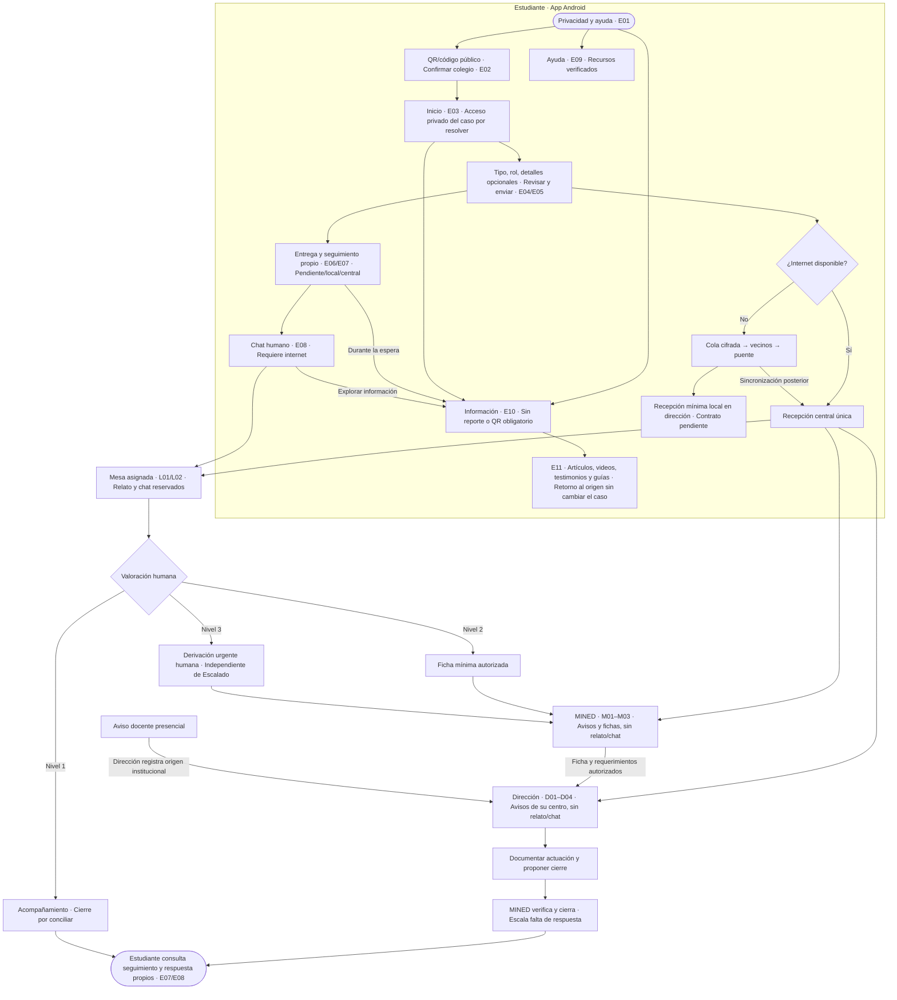

[Vista ampliable](docs/diseno/flujos/08-recorrido-usuarios.svg) · [Fuente editable](docs/diseno/flujos/08-recorrido-usuarios.mmd).

| Usuario | Entrada y tarea principal | Salida y recuperación |
| --- | --- | --- |
| Estudiante | Desde privacidad: explorar Información; o confirmar colegio y redactar/revisar/enviar una solicitud | Seguimiento propio; pendiente, recepción local y central diferenciados. Chat solo con internet. Errores de QR o permisos permiten corregir o consultar ayuda. |
| Mesa de escucha | Acceso autorizado → casos asignados → escucha humana → valoración | Respuesta privada y, si corresponde, ficha mínima o derivación. Sin conexión no se simula conversación. |
| MINED | Acceso autorizado → cola de su ámbito → ficha/actuaciones | Requerir respuesta, escalar demora y validar cierre. Nunca consultar chat o relato. |
| Dirección | Acceso privado → centro propio → aviso/ficha → actuación | Documentar y enviar propuesta de cierre al MINED. Puede registrar un aviso docente con origen institucional. |
| Puente técnico | Función autorizada → custodia de sobres → entrega/sincronización | Estado de transporte y acuses, sin contenido clínico ni autoría del caso. |

<a id="informacion"></a>

### Información y acompañamiento durante la espera

**Decisión confirmada:** la [sesión de Meet del 9 nov a las 13:33 CST](https://docs.google.com/document/d/1c6E9dED-tzHSSu2ciC-TWYNtGH2fxLXYpq14DAt0Eeg/edit) registra la propuesta bajo la etiqueta **Andrea Juárez**, desde **01:21:40**, y la lectura mientras se espera desde **01:23:49**. El acuerdo quedó recogido en el Resumen General de Drive y el usuario confirma su inclusión. [Origen, límites de atribución y análisis del referente](docs/14-espacio-informativo-y-referente-netflix.md).

El portal [Wanna Talk About It? de Netflix](https://www.wannatalkaboutit.com/) sirve como referente de organización informativa y acompañamiento. SéTú tendrá un espacio propio con su marca y recursos revisados/autorizados; no depende de una cuenta Netflix, una API o importar sus contactos/catálogo.

| Entrada | Para qué sirve | Recorrido |
| --- | --- | --- |
| Bienvenida/inicio | Explorar por curiosidad, sin tener que contar un problema | E01/E03 → **E10 Información** → **E11 Recurso**, sin reporte, cuenta o QR obligatorio para leer. |
| Comprender una situación o emoción | Conocer temas, poner palabras a lo que se siente y explorar opciones de apoyo | Elegir artículo, video explicativo, testimonio editorial o guía adaptados a la etapa escolar. Sin diagnóstico o puntuación automática. |
| Entrega/seguimiento/espera | Consultar información mientras llega atención humana | E06/E07/E08 → E10/E11 → volver al origen, conservando operación, redacción y estado real. Leer no significa estar atendido. |

E10 muestra temas, formatos y disponibilidad; E11 permite leer/ver con controles, subtítulos/transcripción y fuente/revisión. Las acciones **Ayuda** y **Pedir apoyo** permanecen disponibles de forma voluntaria; solicitar apoyo valida el colegio si hace falta y no envía automáticamente una alerta. No hay lecturas obligatorias, autoplay o reutilización de casos privados como testimonios.

[](docs/diseno/flujos/13-flujo-informacion.svg)

[Fuente editable](docs/diseno/flujos/13-flujo-informacion.mmd) · [Especificación E10/E11](docs/08-especificacion-funcional-setu.md).

**Sin internet:** solo se ofrece lo realmente empaquetado/descargado y vigente; se indica cuando falta un video y se ofrece una alternativa textual disponible. «Híbrido» significa **información más atención**, sin prometer todos los videos offline. Esta multimedia editorial no viaja por mesh como parte de una alerta.

[↑ Volver al índice](#indice)

<a id="protocolo"></a>

## 6. Protocolo humano y estados

| Nivel decidido por el equipo | Tratamiento previsto | Condición |
| --- | --- | --- |
| 1 · Acompañamiento | Escucha y orientación; puede resolverse en chat | No forzar ficha escolar. |
| 2 · Convivencia / acoso | Ficha y seguimiento MINED–colegio | Información mínima y destinatarios autorizados. |
| 3 · Riesgo grave | Derivación humana a enlaces de protección y salud | Responsables, contactos y protocolo por validar. |

Nombres utilizados por el equipo para el prototipo: **Recibido, En escucha, Ficha enviada, Colegio actuando, Escalado y Cerrado**. El Manual del MINED los presenta como propuesta a ajustar con esa institución: recepción automática, escucha/ficha por la mesa, actuación por dirección y escalamiento/cierre por MINED. No todos los casos recorren todos los estados. Cierre de nivel 1 sin ficha y reapertura requieren completar el contrato. **Derivar por riesgo grave es un evento urgente distinto del estado Escalado**, que el manual utiliza para falta de respuesta institucional. No se espera al siguiente estado para activar una derivación humana.

*Pendiente sin conexión* es un estado de transporte, no un séptimo estado del caso. *Recibido* debe indicar ámbito local o central. Los indicadores de atención necesitan marcas de tiempo definidas; el reloj del emisor no es una autoridad confiable.

Drive plantea doble autorización, registro y aviso para revelación excepcional por protección de la vida. **No existe una identidad civil secreta que la app pueda desanonimizar.** Solo puede compartir información aportada o coordinar una solicitud de contacto según protocolo aprobado. No se convierte el GPS en identificación encubierta ni se promete confidencialidad sin límites.

Los manuales proponen bloquear el paso de contacto familiar mientras el anonimato siga activo y registrar acciones grupales. Su habilitación exige el procedimiento autorizado, con dos aprobadores aún por definir. Debe validarse con responsables de protección: no se convierte esta propuesta en una regla jurídica automática ni se bloquean medidas urgentes que el protocolo aprobado requiera. El sistema debe registrar autorizaciones y limitar qué datos se comparten; no basta ocultar un botón.

El protocolo de acoso entre estudiantes no cubre por sí solo violencia sexual, armas o sustancias. Los manuales mencionan rutas distintas pendientes de acordar con MINED. Esas referencias no agregan automáticamente categorías, formularios o funcionalidades al MVP. Los plazos de atención y escalamiento no están fijados; las metas del Canvas no son un SLA.

<details>
<summary><strong>Ver transiciones propuestas del caso</strong></summary>

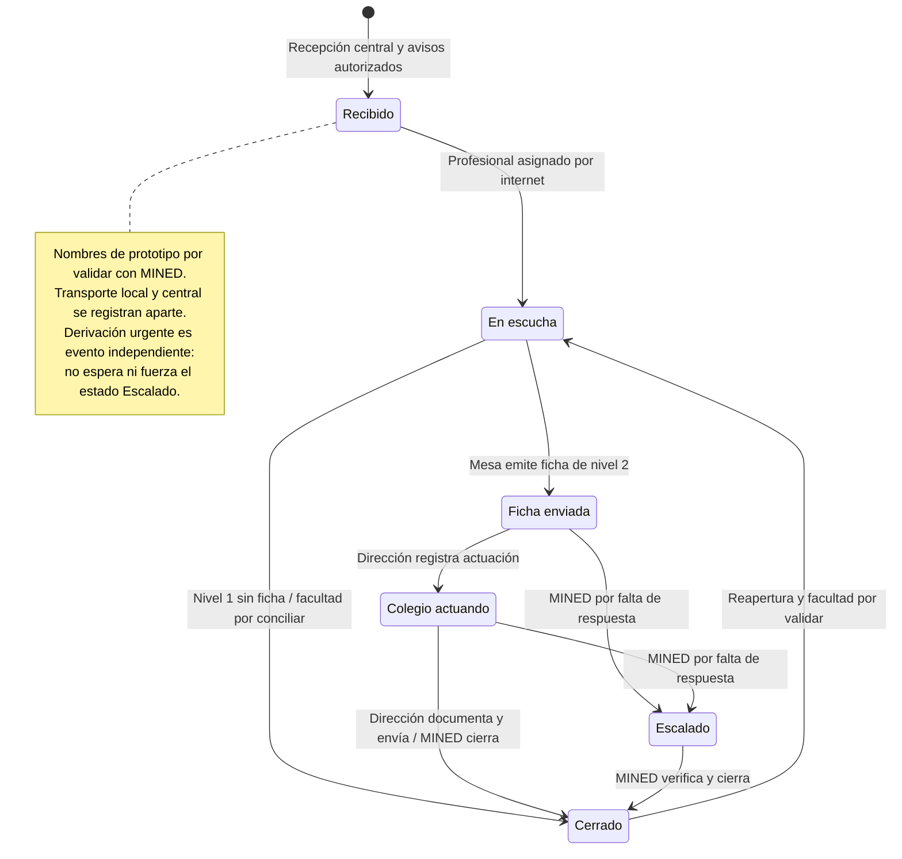

</details>

[↑ Volver al índice](#indice)

<a id="modelado"></a>

# III. Modelado de datos y red mesh

Análisis lógico separado de la navegación y de las decisiones de implementación.

<a id="dfd"></a>

## 7. Flujo de datos lógico según Kendall y Kendall

### Método, símbolos y alcance

Se adopta el enfoque de **Kendall y Kendall**: contexto, diagrama 0 y diccionario/balance de datos. Las entidades externas aportan o reciben información; los procesos numerados la transforman; los almacenes la conservan; las flechas nombran datos. Los números no indican una secuencia. No se usan rombos ni «sí/no» en estos DFD.

Las vistas SVG emplean procesos redondeados, entidades rectangulares y almacenes abiertos a la derecha, de la familia Gane–Sarson; los `.mmd` son fuentes con la misma semántica y una aproximación rectangular del almacén. En el diagrama 0 se repiten entidades/almacenes para facilitar la lectura: **un mismo ID representa el mismo elemento lógico**, sin nuevas copias de datos o permisos. Los bloques no indican orden temporal. El alcance es **recepción, escucha, actuación y seguimiento**; no toda la campaña o la intervención presencial.

Referencia metodológica: Kendall y Kendall, *Systems Analysis and Design*, 10.ª ed., Pearson, 2019, caps. 7–8. La [vista previa oficial](https://www.pearsonhighered.com/assets/preface/0/1/3/4/013478555X.pdf) muestra el contraste lógico/físico y el índice del método. Los modelos siguientes son originales de SéTú, no figuras copiadas del libro.

### Contexto · El sistema y sus participantes

[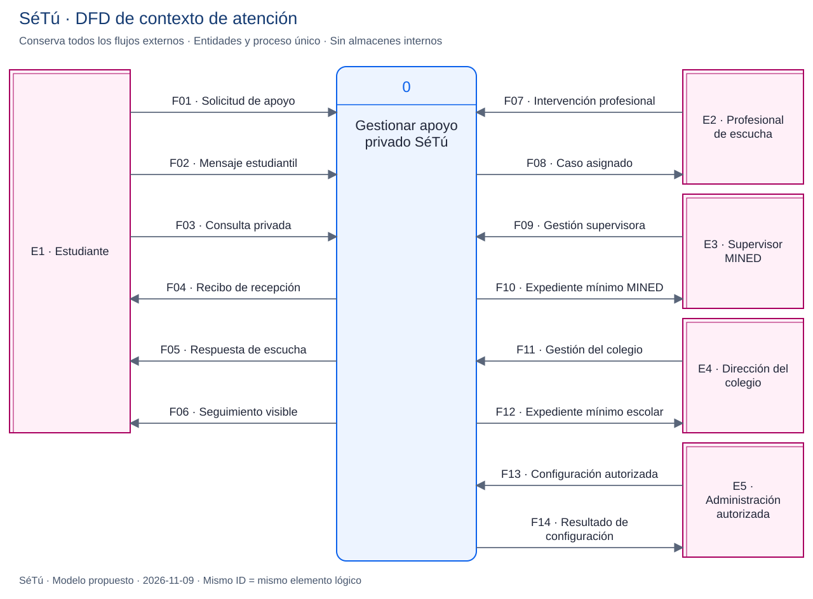](docs/diseno/flujos/09-dfd-contexto.svg)

[Fuente Mermaid](docs/diseno/flujos/09-dfd-contexto.mmd) · Abrir la imagen para ampliarla.

### Diagrama 0 · Transformaciones y almacenes

[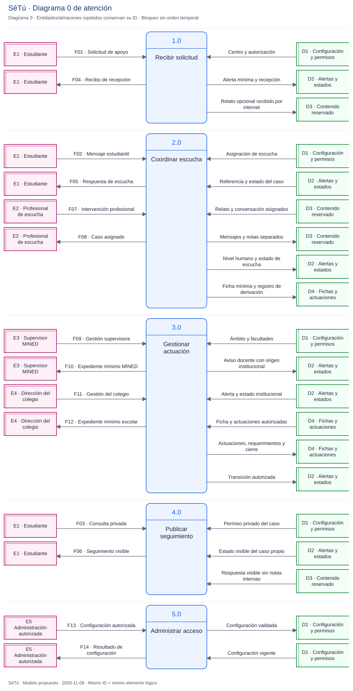](docs/diseno/flujos/10-dfd-diagrama-0.svg)

[Fuente Mermaid](docs/diseno/flujos/10-dfd-diagrama-0.mmd) · Abrir la imagen para ampliarla.

| Proceso | Información que transforma | Almacenes lógicos |
| --- | --- | --- |
| 1.0 Recibir solicitud | Solicitud validada → alerta y recibo; relato opcional por internet reservado | D1 configuración/permisos; D2 alertas/estados; D3 contenido reservado. |
| 2.0 Coordinar escucha | Mensajes e intervención humana → respuesta visible, nivel y ficha mínima cuando procede | D1, D2, D3 y D4 fichas/actuaciones. |
| 3.0 Gestionar actuación | Ficha y gestión institucional → aviso docente, actuaciones, requerimientos y cierre autorizado | D1, D2 y D4; **sin lectura de D3**. |
| 4.0 Publicar seguimiento | Consulta privada → estado y respuesta del caso propio | D1, D2 y proyección visible de D3, sin notas. |
| 5.0 Administrar acceso | Configuración autorizada → centros, ámbitos y asignaciones validados | D1; alta por vía confiable. |

**Balance:** los 14 flujos externos F01–F14 del contexto aparecen con igual dirección y contenido en el diagrama 0. No hay conexiones entidad–almacén ni almacén–almacén. [Diccionario completo, balance y límites](docs/12-modelado-dfd-kendall.md).

El DFD no otorga permisos ni selecciona tablas definitivas. Las salidas de MINED/dirección contienen avisos y fichas autorizados, **nunca relato/chat**. D3 reúne categorías lógicas separadas, no una tabla con acceso común. El permiso privado del caso sigue por aprobar.

### DFD complementario del espacio Información

La biblioteca tiene su propio contexto **I0** y diagrama 0 **I1–I3**, sin vincular lectura con expedientes: **I1 publica contenido ya validado por personas**, **I2 presenta catálogo** e **I3 entrega el recurso**. **D8** conserva recursos editoriales/versiones, separado de los almacenes de casos y mesh. La publicación es una función autorizada, no un CMS o cuarto panel ya implementado.

<details>
<summary><strong>Ver contexto y diagrama 0 de Información</strong></summary>

[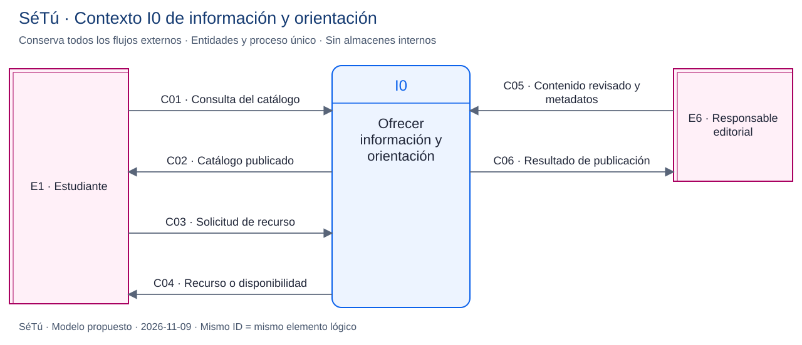](docs/diseno/flujos/14-dfd-informacion-contexto.svg)

[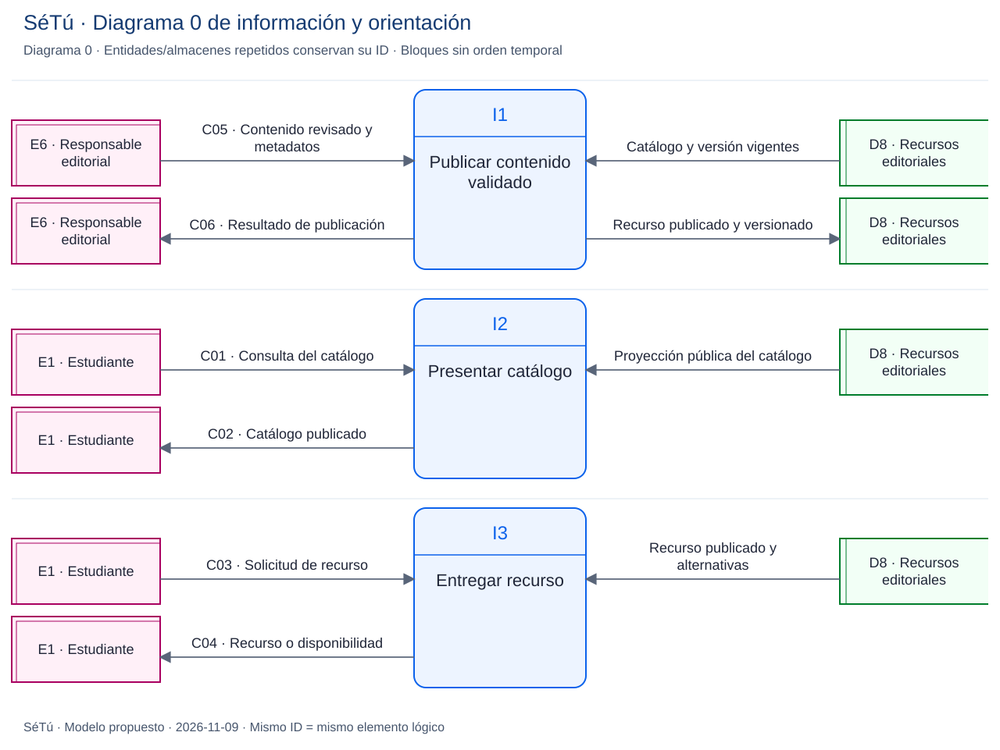](docs/diseno/flujos/15-dfd-informacion-logico.svg)

</details>

Los seis flujos **C01–C06** conservan entidad/dirección/contenido: consulta y catálogo, solicitud y recurso/disponibilidad, contenido revisado y resultado de publicación. [Diccionario y fuentes](docs/14-espacio-informativo-y-referente-netflix.md#6-dfd-del-contenido-editorial). No llevan caso, relato, nivel clínico o una identidad civil del lector.

[↑ Volver al índice](#indice)

<a id="datos"></a>

## 8. Datos y límites de confianza

| Información | Destino permitido | Exclusiones |
| --- | --- | --- |
| Información editorial publicada | Consulta autónoma de temas y recursos revisados | Sin historias privadas de casos ni necesidad de identificarse; publicación/escritura solo autorizadas. |
| Código público escolar | App y validación de centro | No consulta expedientes ni administra. |
| Código privado institucional | Validación/canje de acceso de dirección | No se publica en QR estudiantil, Git ni logs. |
| Alerta mínima: tipo, rol y hora | MINED y dirección autorizados | Sin relato, chat, capturas o identidad civil. Estos metadatos también son sensibles. |
| Relato opcional y chat | Estudiante y mesa de escucha asignada | Nunca MINED, dirección ni retransmisores. |
| Nivel y ficha de actuación | MINED y colegio correspondiente, salvo conflicto | Tipo, rol, hora y nivel humano; sin relato, chat ni capturas. Formato final pendiente. |
| Actuaciones | Supervisión y seguimiento autorizados | Respuesta al estudiante como proyección distinta. |
| Notas internas | Equipo asignado según facultades | Fuera del modelo estudiantil. |
| Sobre cifrado | Retransmisores y puente | Sin sesiones, credenciales o claves privadas del emisor. |
| Auditoría | Supervisión de seguridad | Sin cuerpos del caso, códigos privados ni tokens. |
| Estadísticas agregadas | Centro propio y ámbito MINED autorizado | Sin rankings públicos ni grupos pequeños identificables. |

El modelo propuesto separa instituciones, accesos institucionales, capacidades privadas de caso, reportes, mensajes, notas, fichas, actuaciones, eventos, sobres, acuses y contenidos. Debe distinguir también el origen estudiantil de un aviso docente registrado por dirección, las autorizaciones excepcionales y los pasos de actuación habilitados. Ver [docs/02](docs/02-arquitectura.md). No es un esquema listo para migrar.

### Recepción e idempotencia propuestas

Cada operación tiene un identificador aleatorio persistido y una huella del contenido. Un reintento devuelve el mismo recibo sin duplicar el caso; reutilizar el identificador con otro contenido se rechaza. El servidor verifica la prueba del emisor o capacidad privada del caso, **no atribuye el reporte al usuario del puente**.

La confirmación central se emite después de persistir la recepción. Si se pierde, se consulta o reintenta con la misma operación. Un acuse de puente acredita custodia o recepción local, no lectura profesional ni recepción del MINED.

[↑ Volver al índice](#indice)

<a id="mesh-logico"></a>

## 9. DFD lógico de la red mesh

Esta es una **vista lógica independiente del subsistema de transporte**: tiene contexto M0 y diagrama 0 M1–M5. Complementa la recepción de solicitudes; no se presenta como un diagrama hijo numerado de 1.0. No decide si una situación es grave ni transmite chat.

<details>
<summary><strong>Ver contexto M0 y fronteras del transporte</strong></summary>

[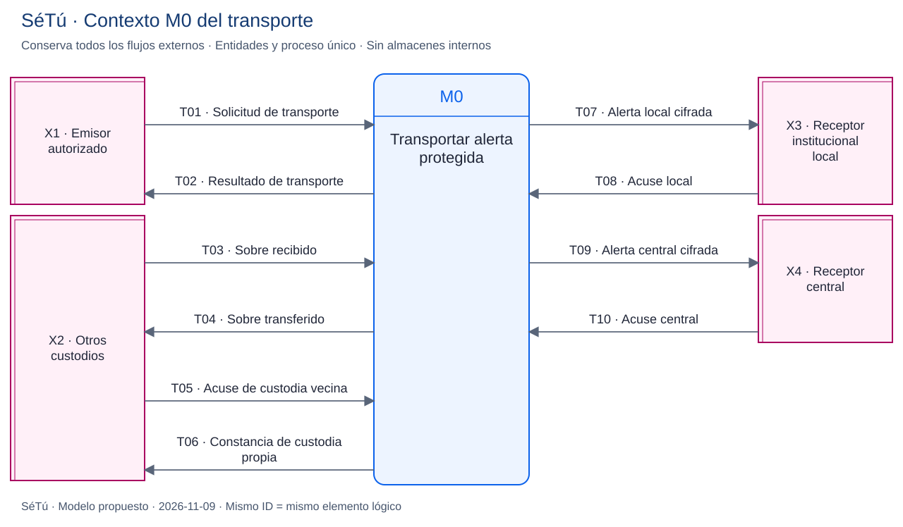](docs/diseno/flujos/11-dfd-mesh-contexto.svg)

[Fuente Mermaid](docs/diseno/flujos/11-dfd-mesh-contexto.mmd) · Abrir la imagen para ampliarla.

</details>

[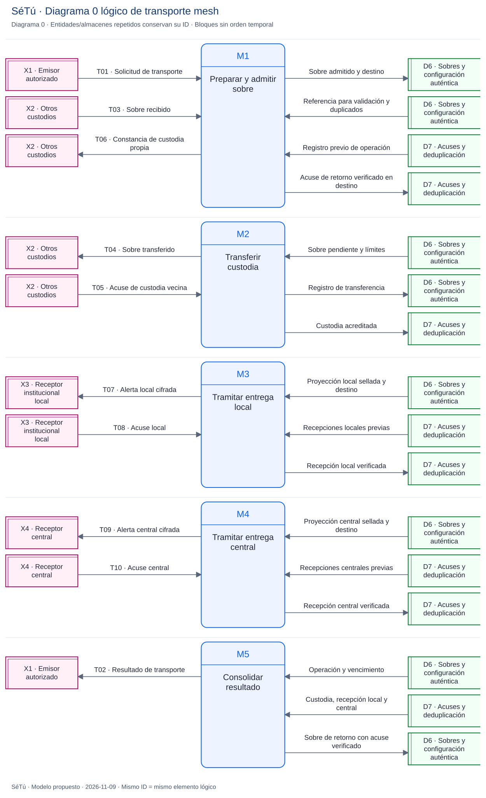](docs/diseno/flujos/12-dfd-mesh-logico.svg)

[Fuente Mermaid](docs/diseno/flujos/12-dfd-mesh-logico.mmd) · Abrir la imagen para ampliarla.

| Proceso | Transformación lógica |
| --- | --- |
| M1 Preparar y admitir sobre | En origen sella la alerta mínima; al recibir de un vecino valida formato/autenticidad/límites **sin leer la carga**. Persiste antes de confirmar custodia. |
| M2 Transferir custodia | Transfiere el sobre opaco y registra evidencia de custodia vecina; no una recepción MINED. |
| M3 Tramitar entrega local | Envía solo la proyección cifrada para dirección y verifica su acuse. Contrato local y claves pendientes. |
| M4 Tramitar entrega central | Remite al receptor central conservando operación/origen y verifica acuse de recepción idempotente. |
| M5 Consolidar resultado | Combina cola y acuses para informar pendiente/custodia/local/central; no produce un estado clínico. |

**D6:** sobres y configuración pública auténtica. **D7:** acuses y deduplicación. Son almacenes distribuidos por instancia, no una BD pública entre teléfonos. Retransmisor y puente no tienen claves privadas de los destinatarios.

**Balance:** T01–T10 se conservan entre contexto y diagrama 0. El [diccionario de transporte](docs/12-modelado-dfd-kendall.md#3-contexto-y-diagrama-0-del-transporte-mesh) distingue los diez contratos. **Custodia ≠ recepción local ≠ recepción central ≠ lectura humana.**

[↑ Volver al índice](#indice)

<a id="mesh"></a>

## 10. Red mesh y funcionamiento físico sin internet

**Decisión del equipo:** la alerta viaja cifrada entre celulares hasta un teléfono puente. **Propuesta técnica:** almacenamiento y reenvío oportunista; un dispositivo conserva sobres y los transfiere cuando encuentra un vecino apto, sin exigir todos los eslabones conectados simultáneamente. La viabilidad física todavía no está probada.

Sin internet se necesitan app compatible, permisos, radios Bluetooth/Wi-Fi según el transporte, batería y encuentros dentro del alcance real. Sin vecinos o puente accesible, el reporte permanece pendiente. No se promete cobertura de todo el colegio ni entrega inmediata.

### Ruta prevista

1. La app dispone de configuración y claves públicas auténticas antes de quedar sin conexión. El primer ingreso totalmente desconectado requiere resolver aprovisionamiento confiable.
2. Genera la operación, cifra para sus destinatarios y guarda la cola protegida.
3. Busca vecinos y transfiere el sobre. El retransmisor no interpreta la situación ni lee el relato.
4. Cada receptor valida formato, tamaño, caducidad y duplicados y guarda antes de confirmar custodia.
5. El puente conserva el sobre y, con un contrato local aprobado, lo entrega al receptor institucional. Puente y dirección son funciones distintas aunque compartan equipo de demo.
6. Con internet restablecido, sube el sobre; el servidor verifica emisor, centro, integridad y unicidad.
7. Un acuse central autenticado puede regresar por internet o por la red oportunista. Sin recibirlo, el emisor mantiene confirmación pendiente aunque el servidor ya tenga el caso.

### Cifrado y destinatarios

El cifrado local M1 y el cifrado del enlace inalámbrico no bastan para una cadena de intermediarios. Hace falta un **sobre cifrado de extremo a extremo hasta su destinatario autorizado**. Retransmisores y puente no tienen la clave para leer relato/chat. Si dirección debe leer una alerta mínima offline, necesita un destinatario y claves distintos de los del circuito de escucha.

No se incluye una clave común en todos los APK ni se usa el código del colegio como clave de cifrado. Distribución de claves públicas, rotación, revocación, autenticación de acuses y recuperación están pendientes. El cifrado no oculta por completo proximidad, horarios, tamaños y patrones de tráfico.

### Transporte candidato

[Nearby Connections](https://developers.google.com/nearby/connections/overview) permite conexiones cercanas sin internet usando Bluetooth/BLE/Wi-Fi; [Cluster](https://developers.google.com/nearby/connections/strategies) admite varios vecinos. Se propone evaluarlo. La conexión entre vecinos no sustituye el protocolo de retransmisión, deduplicación y acuses de SéTú.

Los [permisos necesarios](https://developers.google.com/nearby/connections/android/get-started) dependen de versión y transporte. Android aplica [restricciones en segundo plano](https://developer.android.com/develop/connectivity/bluetooth/ble/background). Primero se probarán equipos concretos con apps visibles; no se promete reenvío continuo con la app cerrada. ADR 0008 propone evaluar un canal nativo Kotlin desde Flutter hacia Nearby Connections/Cluster. Google Play services, consumo, compatibilidad y versiones requieren prueba aprobada; no se ha elegido o instalado un plugin.

Ver [flujo de datos y red mesh](docs/10-flujo-datos-y-red-mesh.md) para sobres, estados, colas, retorno, sincronización y pruebas.

### Ruta de ejecución y fallos

Este flujo sí incluye decisiones de conectividad: corresponde a ejecución, no a un DFD lógico.

[](docs/diseno/flujos/06-mesh.svg)

[Fuente Mermaid](docs/diseno/flujos/06-mesh.mmd) · Abrir la imagen para ampliarla.

**Límite web:** una web cloud no recibe por Bluetooth una alerta desde el puente por estar abierta. Hay que aprobar un receptor local autorizado, claves y enlace seguro: vista nativa o servicio LAN con cliente disponible offline. PWA/caché por sí solas no resuelven recepción, confidencialidad o sincronización.

[↑ Volver al índice](#indice)

<a id="desarrollo"></a>

# IV. Especificación para desarrollo

Tecnología confirmada, recursos propuestos y estado ejecutable, con sus diferencias explícitas.

<a id="arquitectura"></a>

## 11. Arquitectura de componentes objetivo

**Stack confirmado:** Flutter/Dart para Android y Supabase/PostgreSQL como backend objetivo. **Propuesta ADR 0008:** cliente web React/TypeScript/Vite para MINED, escucha y dirección; Nearby/Cluster vía canal Kotlin para evaluar proximidad. No implementados.

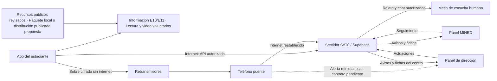

Las flechas representan destinos lógicos, no acceso a tablas completas. La rama local punteada figura en Drive; contenido, claves y autenticación deben aprobarse antes de implementarla.

| Componente | Función | Estado |
| --- | --- | --- |
| App Flutter y `go_router` | APK Android y navegación | Base implementada; nuevo recorrido pendiente. |
| Almacén AES-GCM-256 | Proteger datos ficticios al reiniciar | Implementado M1; adaptación como cola pendiente. |
| API de aplicación | Validación, recepción idempotente y permisos | Propuesta; sin backend conectado. |
| PostgreSQL y RLS | Aislamiento por institución y recurso | Objetivo confirmado; esquema/políticas no implementados. |
| Paneles y mesa | React/TypeScript/Vite propuestos; vistas por función | Diseñados; no implementados. |
| Transporte de proximidad | Canal Dart–Kotlin → Nearby Connections/Cluster propuesto | Candidato, sin instalación o prueba. |
| Protocolo de reenvío | Colas, caducidad, deduplicación y acuses | Propuesta técnica. |
| Enlace local puente–dirección | Recepción escolar sin internet | Pendiente; una web alojada en internet no basta. |

Esta es una vista de componentes, distinta de los DFD. Cloudflare Pages se propone para alojar la web estática; Supabase para API/datos. FCM sigue fuera del MVP aprobado. No se crean microservicios, cuentas, despliegues o dependencias por describirlos.

[↑ Volver al índice](#indice)

<a id="stack"></a>

## 12. Lenguajes y recursos técnicos de todo el sistema

La matriz cubre app, panel MINED, mesa, panel institucional, backend y proximidad. **Confirmado** significa objetivo acordado; **propuesto/candidato** requiere aprobación de implementación. Las versiones nuevas se resolverán juntas antes de instalarlas; no se atribuye compatibilidad probada a una lista de herramientas.

| Capa o superficie | Lenguajes | Recursos a integrar o conservar | Estado |
| --- | --- | --- | --- |
| App Android | **Dart**, Kotlin nativo cuando haga falta | Flutter, `go_router`, `cryptography`, `flutter_secure_storage`, `path_provider`, Poppins local | Base M1 implementada; nuevo flujo pendiente. |
| Información E10/E11 | **Dart + JSON**; texto y medios editoriales | Widgets Flutter; catálogo/recursos empaquetados propuestos; `video_player` candidato para reproducción local o de red | Producto confirmado; implementación, versiones, catálogo y derechos pendientes. No es una API de Netflix. |
| QR y cercanía | Dart; APIs Android | Candidatos `mobile_scanner` y, condicionado al diseño de privacidad, `geolocator`; código manual alternativo | No instalados. GPS no guarda ubicación precisa; finalidad/alternativas por resolver. |
| Panel MINED | **TypeScript/TSX + HTML + CSS** | **React + Vite + React Router + `@supabase/supabase-js`** | Propuesta ADR 0008; avisos, fichas y supervisión sin chat. |
| Mesa de escucha | TypeScript/TSX + HTML + CSS | Mismo cliente web, vistas y contratos del rol de escucha | Propuesto; chat humano conectado y casos asignados. |
| Panel de instituciones | TypeScript/TSX + HTML + CSS | Mismo cliente web, proyecciones del centro y tokens de marca | Propuesto; actuaciones y propuesta de cierre sin relato/chat. |
| Backend y autorización | **SQL / PLpgSQL** | **Supabase/PostgreSQL**, Auth de personal, RLS y RPC transaccionales | Plataforma objetivo confirmada; contratos, esquema y políticas propuestos. |
| SDK móvil de backend | Dart | `supabase_flutter` | Propuesto; no presente en M1. Acceso privado estudiantil por decidir. |
| Operaciones confiables | **TypeScript / Deno** | Supabase Edge Functions solo cuando sean necesarias | Propuesto; no servidor Node adicional. |
| Actualizaciones y chat | Dart/TypeScript + SQL | Realtime autorizado y mensajes persistidos, reintentos idempotentes | Propuesto; internet obligatorio, sin relato en avisos. |
| Transporte entre vecinos | **Dart + Kotlin** | Canal de plataforma Flutter → Google Play services Nearby Connections/Cluster | Candidato a experimento; falta protocolo multisalto propio. |
| Cola y sobre mesh | Dart/Kotlin; formato por aprobar | Persistencia protegida, sello por destinatario, deduplicación y acuses | Diseño pendiente de claves/biblioteca de sobre. AES local no acredita E2EE. |
| Puente → dirección local | Por decidir según receptor | Vista nativa autorizada **o** servicio LAN seguro con cliente disponible offline | Decisión abierta; web cloud insuficiente para esa entrega. |
| Web alojada | HTML/CSS/JS del build | Cloudflare Pages estático; backend en Supabase | Propuesto; sin publicación o dominio configurado. |
| Construcción | CLI; configuración según herramienta | Flutter/Android/JDK actuales; Node.js compatible con Vite + npm/lockfile propuestos | Node es herramienta de build web. No hay proyecto npm creado. |
| Calidad | Dart, TypeScript y SQL | Flutter analyze/test existentes; Vitest + React Testing Library, ESLint y Playwright propuestos; integración RLS/RPC | Falta implementación web/BD y pruebas físicas mesh. |
| Diseño/documentación | SVG, fuentes, Markdown, Mermaid | Logo oficial, Poppins, tokens del manual; Clayful sujeto a licencia/disponibilidad | Recursos documentados; sin reconstruir la marca. |

Se contrastaron las capacidades con [React/TypeScript](https://react.dev/learn/typescript), [Vite](https://vite.dev/guide/), [Supabase](https://supabase.com/docs/reference/javascript/introduction), [canales Flutter](https://docs.flutter.dev/platform-integration/platform-channels), [Nearby](https://developers.google.com/nearby/connections/strategies) y [Pages](https://developers.cloudflare.com/pages/framework-guides/deploy-a-react-site/). Ver [catálogo técnico completo](docs/13-recursos-tecnicos.md) para fuentes de cada recurso, requisitos, contratos, configuración y límites.

No se agregan Firebase, mapas, analítica, IA, evidencias multimedia, framework CSS o push por aparecer en referentes/costos. Una web pública de campaña y un CMS no están implementados ni son prerrequisitos de los paneles.

[↑ Volver al índice](#indice)

<a id="paneles"></a>

## 13. Sitio web de paneles: integración propuesta

**Propuesta:** una sola SPA privada React/TypeScript con tres áreas de trabajo y componentes reutilizables. Mismo despliegue no significa mismos datos: servidor y BD deciden rol, ámbito, asignación y operaciones. No se descarga el chat para después ocultarlo en la interfaz.

| Área | Pantallas de referencia | Recursos funcionales |
| --- | --- | --- |
| MINED | M01–M03 | Acceso autorizado, lista/filtros del ámbito, aviso/ficha, actuaciones, requerimientos, escalamiento por demora y cierre. |
| Escucha asignada | L01–L02 | Lista de asignados, relato y conversación, notas separadas, nivel humano, ficha mínima y registro de derivación. |
| Institución | D01–D04 | Acceso privado, avisos/fichas del centro, pasos autorizados, registro de aviso docente, documentar/enviar al MINED y agregados permitidos. |

**Interfaz propuesta:** React Router; hooks/contexto para estado local; HTML semántico y CSS con variables de marca; sin biblioteca de estado o diseño adicional por defecto. Versiones, rutas definitivas, directorio y dependencias se definen al aprobar el bloque web.

**Integración propuesta:** cliente Supabase JS para sesiones y consultas permitidas; RLS/RPC para datos y transiciones; Realtime solo en canales autorizados. La sesión institucional proviene de un alta confiable: un campo editable o un selector de centro no asigna rol. Sesión MINED y rol de escucha se separan explícitamente.

**Distribución propuesta:** Vite genera archivos estáticos para Pages por HTTPS; Node/npm se usan en construcción. Los secretos no entran en `VITE_*`, JavaScript publicado o `dart-define`. URL y clave pública de cliente no reemplazan autorización. `service_role`, códigos privados y claves de descifrado nunca van en el bundle.

**Sin conexión:** los paneles cloud no se declaran operativos offline. Primera carga, receptor local, caché protegida, terminal compartida, revocación y sincronización deben resolverse. No guardar casos por defecto en `localStorage` o caché PWA.

**Pruebas previstas:** teclado/lector de pantalla, formularios y estados vacíos/error/reconexión, aislamiento de dos centros, separación MINED–mesa, accesos revocados y transiciones. Los contratos y alternativas React frente a Flutter Web/Next.js están en [ADR 0008](docs/decisiones/0008-stack-web-y-modelado-logico-propuesto.md).

[↑ Volver al índice](#indice)

<a id="app"></a>

## 14. App Android y estado comprobable del código

### Tecnologías y versiones del corte M1

Las versiones siguientes provienen de `pubspec.yaml`, `pubspec.lock` y la bitácora M1; son la base registrada del proyecto, no una recomendación de usar versiones recordadas al iniciar un bloque nuevo.

| Capa | Tecnología/version registrada | Uso actual |
| --- | --- | --- |
| Aplicación | Flutter 3.44.5 stable / Dart 3.12.2 | Base Android 0.2.0+2. |
| Navegación | `go_router` 18.1.3 | Arranque y navegación base; recorrido ampliado pendiente. |
| Criptografía local | `cryptography` 2.9.0 | AES-GCM-256 y derivaciones de credenciales M1. |
| Custodia de clave | `flutter_secure_storage` 11.2.0 | Almacenamiento seguro del secreto local. |
| Archivo privado | `path_provider` 2.1.6 | Ruta del almacén cifrado. |
| Análisis y pruebas | `flutter_lints` 6.0.0 / `flutter_test` del SDK | Casts, inferencia y tipos genéricos estrictos; pruebas de lógica/widgets. |
| Android registrado | SDK 36.1.0; APK M1 mínimo API 24, target 36 | La configuración Gradle obtiene niveles del SDK Flutter; comprobar manifiesto del APK al recompilar. |
| Java de construcción | JDK 21 de Android Studio; compatibilidad Java/Kotlin 17 | Entorno usado en M1, sin cambiar la instalación del equipo. |
| Backend objetivo | Supabase / PostgreSQL | No hay `supabase_flutter`, esquema, políticas o servidor conectado en el corte actual. |

Android es la plataforma inicial aprobada. No se afirman iOS, web o Windows como clientes implementados por usar Flutter. La propuesta independiente para paneles es React/TypeScript/Vite (ADR 0008), pendiente de aprobación e implementación.

| Implementación M1 | Límite |
| --- | --- |
| Flutter Android, `go_router` y pantalla de verificación | Nuevo recorrido completo pendiente. |
| Tema, Poppins empaquetada y motivos | Algunos colores del código siguen siendo del manual inicial. |
| `FLAG_SECURE` y control nativo | Reactivación al arrancar; prueba física M1 pendiente según bitácora. |
| `CureandoGateway` / `StaffCureandoGateway` | Contratos previos de alias y atención local. |
| `LocalCureandoGateway`, archivo AES-GCM-256 y almacenamiento seguro de clave | Datos ficticios de un teléfono; sin red ni backend. |
| Credenciales derivadas, permisos locales e idempotencia | No acreditan RLS ni deduplicación entre dispositivos. |
| Pruebas y APK registrados | 18 pruebas y análisis limpio documentados el 5 nov; no verifican el sistema ampliado. |

**No implementado:** acceso nuevo, QR/GPS, continuidad sin cuenta visible, catálogo/lectura/video E10/E11, paneles conectados, escucha remota, recepción central, red mesh, colas de reenvío, puente y servicio local a dirección.

Los estados del código (`received`, `inReview`, `accompanied`, `closed`) no equivalen a los seis nuevos. Adaptarlos requiere aprobación y pruebas; si cambia el formato local, también una estrategia explícita de migración. No subir automáticamente los datos M1 al futuro backend.

### Organización existente

```text
apps/mobile/                 Aplicación Flutter Android
  lib/shared/                Contratos, modelos, almacén, tema y widgets
  test/                      Pruebas locales y de interfaz
docs/                        Producto, arquitectura, operación y diseño
  decisiones/                ADR y propuestas identificadas
  diseno/flujos/             Diagramas
```

No existen todavía `lib/features/`, migraciones Supabase ni paneles operativos. La organización por funcionalidad está prevista para los próximos bloques aprobados; no crear carpetas vacías o infraestructura por anticipado.

Puntos de entrada: `lib/main.dart` inicia la app; `lib/app.dart` ensambla la pantalla base. En `lib/shared/` se encuentran `contracts/`, `models/`, `local/`, `platform/`, `theme/` y `widgets/`. `shared/mock/` se utiliza para pruebas; no sustituye una conexión institucional. Los tests actuales están en `test/local_gateway_test.dart` y `test/app_test.dart`. Poppins y su licencia se incluyen en `assets/fonts/`.

[↑ Volver al índice](#indice)

<a id="instalacion"></a>

## 15. Ejecutar el corte existente

### Requisitos e instalación

Se necesitan Git, Flutter con Dart compatible, herramientas Android y un emulador o teléfono de prueba autorizado. El entorno de referencia está descrito arriba. No hace falta crear cuentas Supabase, Firebase o Google Cloud para el corte local M1.

```powershell
git clone https://github.com/JaBaca67/Setu-Unicef-Bugnuelitos-UAM.git
cd Setu-Unicef-Bugnuelitos-UAM/apps/mobile
flutter --version
flutter doctor -v
flutter pub get
flutter devices
flutter run
```

### Comandos de trabajo

Desde `apps/mobile/`:

```powershell
flutter pub get
flutter analyze
flutter test
flutter build apk --debug
```

[README móvil](apps/mobile/README.md) detalla herramientas, almacenamiento y comprobaciones físicas. Documenta `C:\flutter\bin\flutter.bat` para esta computadora. Conservar `pubspec.lock`; esta revisión no actualiza paquetes. Al iniciar otro bloque, verificar compatibilidad en documentación oficial.

APK en `build/app/outputs/flutter-apk/app-debug.apk`, excluido de Git. Instalación USB con dispositivo autorizado. Compilar el corte local no prueba el sistema conectado.

| Comando | Finalidad |
| --- | --- |
| `flutter analyze` | Análisis estático según `analysis_options.yaml`. |
| `flutter test test/local_gateway_test.dart` | Persistencia, permisos locales, integridad e idempotencia M1. |
| `flutter test test/app_test.dart` | Widgets y comportamiento del canal simulado. |
| `dart format --output=none --set-exit-if-changed lib test` | Comprobar formato sin escribir. |
| `flutter test --dart-define=SETU_CAPTURE_QA=true test/app_test.dart` | QA de widgets documentada en el README móvil; capturas bajo `build/qa/`. |
| `flutter build apk --debug` | Compilar la demo local con firma de depuración. |

### Configuración, secretos y archivos locales

El corte actual no tiene `.env` obligatorio, `firebase_options.dart`, claves de mapas ni credenciales de backend. No copiar esos archivos o requisitos del README de Nikara. No incluir secretos al preparar los futuros paneles o servidor.

El archivo `setu_local_store.enc` es dato privado de ejecución y no se distribuye con el repositorio. Android excluye copias cloud/transferencias del corte actual. `android/local.properties`, cachés, APK y credenciales de firma son locales; `.gitignore` los protege según su finalidad. La compilación `release` conserva firma debug provisional en Gradle: no es una configuración de publicación lista para tiendas.

El manifiesto principal todavía no pide cámara, Bluetooth, proximidad o ubicación. Los manifiestos debug/profile incluyen internet para desarrollo; eso no demuestra envío de casos ni backend. Los permisos nuevos se diseñarán y aprobarán con su funcionalidad.

### Solución de problemas

| Síntoma | Comprobación o acción |
| --- | --- |
| Flutter no se reconoce | Usar la ruta local documentada o configurar el entorno propio; comprobar `flutter --version`. |
| Dependencias/SDK incompatibles | Revisar `flutter doctor -v`, restricción Dart y `pubspec.lock`; no actualizar paquetes a ciegas. |
| No aparece teléfono | Revisar cable, depuración USB y autorización personal; `flutter devices` o `adb devices -l`. |
| No permite captura | M1 activa `FLAG_SECURE`; su control de prueba pide confirmación y se reactiva al arrancar. |
| Error de clave/integridad local | Conservar el archivo, no borrar ni reinicializar automáticamente. La pérdida de clave puede impedir recuperar la demo. |
| El aviso no llega a otro dispositivo | M1 es local; no existe transporte mesh ni servidor para recibirlo. |
| Falta de acceso tras borrar datos | Recuperación remota no implementada; el respaldo M1 no restaura una clave o archivo eliminados. |

[↑ Volver al índice](#indice)

<a id="seguridad"></a>

## 16. Seguridad, privacidad y accesibilidad

- Autorización en servidor y base de datos; denegación por defecto y aislamiento institucional. Roles administrados por una vía confiable.
- Permisos separados para aviso, chat, ficha, nota y actuación. Acceder al panel MINED no concede todo el expediente.
- Sesiones y claves protegidas; códigos privados nunca en claro. Altas, bajas y sustitución de enlace auditables.
- Validación, cuotas y transiciones en servidor. Reintentos y recepciones simultáneas transaccionales.
- Cifrado local y de enlaces, además del sobre hasta su destinatario. No se declara E2EE integral ya implementado.
- Sin relatos en notificaciones, telemetría, auditoría o errores. Anuncios de proximidad sin nombres personales o del teléfono.
- Agregados revisados contra reidentificación. Reconocimientos no premian pocos reportes o cierres precipitados.
- Continuidad privada en teléfonos compartidos y recuperación después de borrar datos necesitan decisión explícita.
- Español sencillo, texto ampliable, lector de pantalla y estados con texto además de color. Comprensión adaptada a primaria y secundaria.

Los casos reales requieren [protección y operación](docs/03-proteccion-y-operacion.md): responsable institucional, atención humana, protocolo, revisión local del tratamiento de datos, retención, incidentes y ayuda verificada. Esta demo no habilita el servicio.

[↑ Volver al índice](#indice)

<a id="pruebas"></a>

## 17. Aceptación del sistema ampliado

| Escenario | Evidencia necesaria |
| --- | --- |
| Información autónoma y durante la espera | Abrir sin reporte/QR; artículo/video accesible con disponibilidad real; volver conservando operación/estado, sin enviar datos del caso a contenido o crear otra alerta. |
| Acceso escolar | QR/código sin cuenta visible, errores y permisos denegados comprensibles; código público sin acceso a casos. |
| Privacidad por caso | Dos estudiantes del mismo centro no consultan casos ajenos; continuidad privada verificable. |
| Aislamiento institucional | Centro A no lee/escribe recursos B alterando identificadores; roles MINED limitados por ámbito. |
| Chat frente a ficha | MINED y dirección no reciben chat, relato ni notas en API, caché o canal local. |
| Recepción por internet | Persistencia antes del recibo; respuesta perdida y reintento sin duplicar. |
| Dos saltos sin internet | Emisor → retransmisor → puente, impidiendo contacto directo emisor–puente; intermediario sin plaintext. |
| Reinicio y corte de radio | Recuperación protegida de cola y reintentos sin pérdida silenciosa. |
| Sincronización del puente | Un caso central pese a varias rutas; recepción local diferenciada y acuse auténtico. |
| Integridad y abuso | Sobres alterados, repetidos, vencidos y límites probados sin exponer contenido. |
| Protocolo | Transiciones permitidas/denegadas, conflicto y derivación con casos ficticios. |
| Accesibilidad | Texto ampliado, lector de pantalla y comprensión en primaria/secundaria. |

Permisos, aislamiento, transiciones y reintentos requieren integración cuando exista backend. Mesh exige teléfonos físicos: una simulación no acredita radio, alcance ni funcionamiento con pantalla apagada.

[↑ Volver al índice](#indice)

<a id="gestion"></a>

# V. Decisiones, trazabilidad y colaboración

Cómo mantener esta especificación alineada con Drive y el repositorio.

<a id="decisiones"></a>

## 18. Estado y autoridad de las decisiones

| Etiqueta | Significado |
| --- | --- |
| Implementado | Existe en el código; se explican límites y verificaciones disponibles. |
| Decisión del equipo | Dirección de producto registrada en Drive; no implica implementación. |
| Propuesta técnica | Alternativa para materializarla; requiere aprobación antes de programar. |
| Pendiente | Falta un acuerdo, validación o prueba que cambia el resultado. |

Las fuentes de producto están en el [Drive del equipo](https://drive.google.com/drive/folders/1BSIhalcR9OKPbfXwTDoexnr12lPAXE6c). Su revisión se registra en [docs/09](docs/09-revision-drive-y-trazabilidad.md). [ADR 0005](docs/decisiones/0005-alineacion-con-decisiones-del-equipo-drive.md) reemplaza el acceso por alias + PIN de ADR 0003. [ADR 0006](docs/decisiones/0006-especificacion-tecnica-y-mesh-propuesta.md) registra las propuestas técnicas de esta especificación **sin declararlas aprobadas**. [ADR 0007](docs/decisiones/0007-alineacion-con-manuales-operativos.md) incorpora las precisiones de los nuevos manuales de uso, todavía sujetos a validación institucional.

[ADR 0008](docs/decisiones/0008-stack-web-y-modelado-logico-propuesto.md) añade la propuesta de stack web y la separación de modelos lógicos/físicos. No autoriza programación, dependencias, migraciones o despliegues. [docs/13](docs/13-recursos-tecnicos.md) distingue selección candidata de compatibilidad realmente probada.

[ADR 0009](docs/decisiones/0009-espacio-informativo-confirmado.md) confirma Información como componente del producto, respaldado por Meet, resumen de Drive e instrucción del usuario. Su existencia no se vuelve a tratar como opcional; catálogo, revisión, derechos y tecnología conservan decisiones de implementación pendientes.

[↑ Volver al índice](#indice)

<a id="pendientes"></a>

## 19. Próximos bloques y pendientes

Secuencia propuesta, con aprobación previa de cada bloque:

1. Resolver destinatarios offline, acceso privado por caso, códigos institucionales e ingreso inicial desconectado.
2. Probar físicamente transporte y dos saltos: entrega, permisos, reinicio y batería.
3. Aprobar contratos mínimos y autorización; probar aislamiento e idempotencia.
4. Desarrollar el recorrido vertical y tres superficies con datos ficticios.
5. Integrar cola, puente, recepción central y acuses; mostrar fallas y recuperación.
6. Completar interfaz y guion de demo, declarando lo funcional y lo simulado.

Antes de desarrollar paneles, aprobar o ajustar React/TypeScript/Vite, el acceso del personal y contratos por superficie. Antes de mesh, resolver claves, primer ingreso offline, receptor local y experimento físico. El [plan vigente](docs/04-plan.md) conserva todas las decisiones que condicionan la implementación.

[↑ Volver al índice](#indice)

<a id="documentacion"></a>

## 20. Biblioteca de documentación

| Documento | Contenido |
| --- | --- |
| [Producto](docs/01-producto.md) | Alcance vigente y actores. |
| [Arquitectura](docs/02-arquitectura.md) | Identidad técnica, datos, permisos y transiciones propuestas. |
| [Protección y operación](docs/03-proteccion-y-operacion.md) | Condiciones del eventual servicio real. |
| [Plan](docs/04-plan.md) | Prioridades y decisiones abiertas. |
| [Diseño](docs/06-guia-diseno.md) | Marca y accesibilidad. |
| [Plan del prototipo](docs/07-plan-mockup-y-codex.md) | Bloques y demostración. |
| [Especificación funcional](docs/08-especificacion-funcional-setu.md) | Pantallas y flujos por superficie. |
| [Revisión de Drive](docs/09-revision-drive-y-trazabilidad.md) | Inventario, fuentes y discrepancias. |
| [Accesos para Drive](docs/11-acceso-a-especificacion-tecnica.md) | Contenido preparado con el repositorio y los accesos principales. |
| [Datos y mesh](docs/10-flujo-datos-y-red-mesh.md) | Protocolo de transporte propuesto y pruebas. |
| [DFD Kendall y Kendall](docs/12-modelado-dfd-kendall.md) | Método, diccionario, contexto/diagrama 0 y balance de atención/transporte. |
| [Recursos técnicos](docs/13-recursos-tecnicos.md) | Lenguajes, SDK, web, backend, proximidad y fuentes oficiales. |
| [Información y referente Netflix](docs/14-espacio-informativo-y-referente-netflix.md) | Evidencia de Meet, uso durante la espera, E10/E11, recursos editoriales y DFD C01–C06. |
| [Diagramas vigentes](docs/diseno/flujos/README.md) | Acceso, navegación, reporte, atención, datos, mesh y estados. |
| [Fichas de pantalla](docs/diseno/pantallas-explicadas.md) | Acciones, entradas, salidas y variantes. |

[↑ Volver al índice](#indice)

<a id="colaboracion"></a>

## 21. Colaboración y guardado

Aplican [AGENTS.md](AGENTS.md) y la aprobación explícita antes de código, dependencias, migraciones o estructuras. Documentar una alternativa no autoriza implementarla. Guardar avances coherentes en commits pequeños y revisados y hacer push al cerrar el bloque autorizado cuando el remoto esté disponible.

Solo datos ficticios. No versionar APK, secretos, claves, bases locales, respuestas individuales ni transcripciones con información personal. Los originales quedan en Drive; el repositorio conserva síntesis y trazabilidad pertinentes.

[↑ Volver al índice](#indice)
