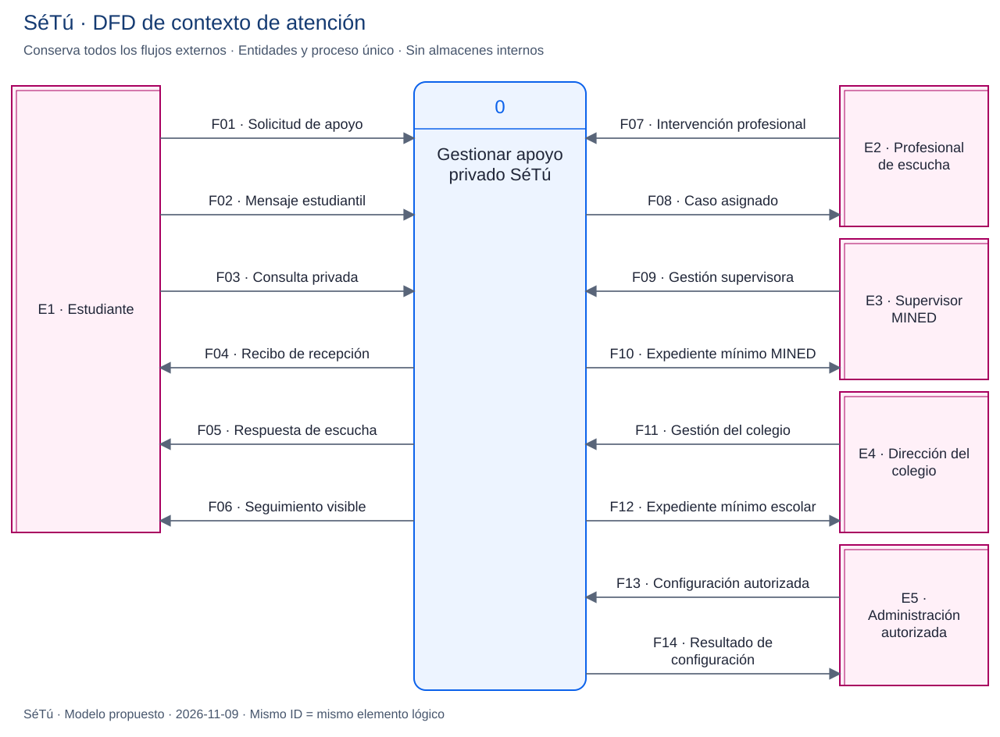
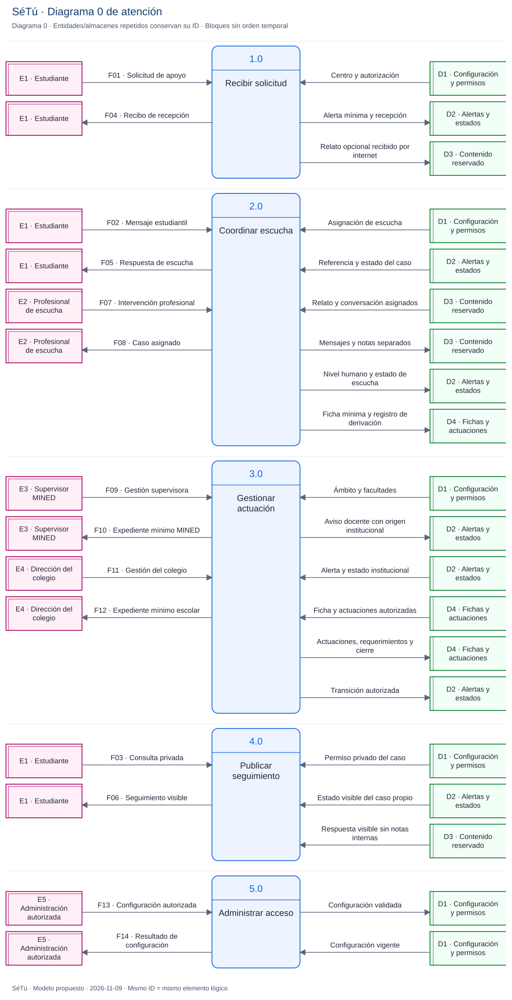
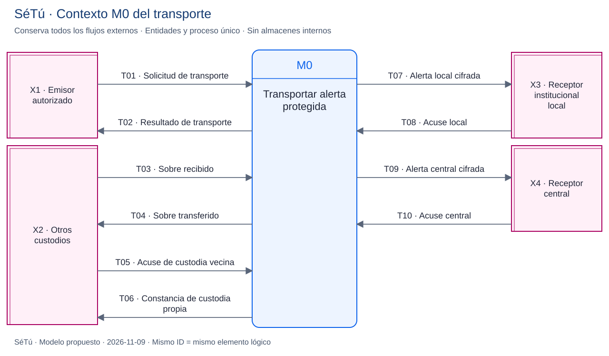
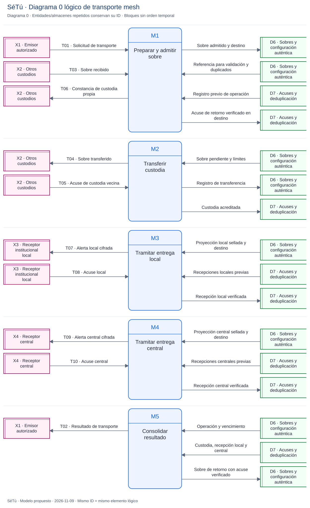

# Modelado de datos según Kendall y Kendall

**Revisión:** 2026-11-09. Modelos originales de análisis de SéTú; propuestos, sin backend o mesh implementados. [README](../README.md) · [Fuentes editables y vistas](diseno/flujos/README.md).

## Método y alcance

Referencia: Kenneth E. Kendall y Julie E. Kendall, *Systems Analysis and Design*, 10.ª edición, Pearson, 2019, capítulos 7 y 8. La [vista previa oficial](https://www.pearsonhighered.com/assets/preface/0/1/3/4/013478555X.pdf) permite comprobar el índice, el ejemplo lógico/físico del prefacio y la referencia al balance vertical. No se reproduce una figura del libro ni se afirma haber consultado el capítulo completo.

Se aplica la secuencia contexto → diagrama 0, con diccionario y conservación de entradas/salidas. El DFD lógico expresa transformaciones de información; la arquitectura física especifica dispositivos y tecnologías. La numeración identifica procesos, sin ordenar su ejecución. Las decisiones de navegación pertenecen al flujo de usuarios.

Las vistas SVG usan rectángulos de entidad externa, procesos redondeados numerados, almacenes abiertos a la derecha y flechas de datos nombradas, siguiendo la familia de notación Gane–Sarson utilizada en este enfoque. Mermaid conserva la misma semántica, con rectángulos de almacén como aproximación visual. El índice de flujos enlaza ambas versiones; la notación de almacén de referencia es la del SVG. En los diagramas 0 se repiten entidades/almacenes por legibilidad: **el mismo ID representa el mismo elemento**, no otra copia de datos o un nuevo permiso. Los bloques se leen como procesos del mismo nivel, no como pasos de una secuencia.

El límite del **modelo de atención** es el software que recibe solicitudes, facilita escucha humana, gestiona actuaciones y publica seguimiento. No modela toda la campaña, edición de contenidos, decisiones clínicas o intervención presencial. MINSA, MIFAN y otros organismos no se dibujan como APIs integradas: no existe ese contrato.

El **modelo de transporte** tiene su propio contexto M0 y diagrama 0 M1–M5. Es una vista complementaria del transporte usado al recibir solicitudes, no una descomposición numerada de 1.0. Sus destinatarios son funciones de información; Bluetooth, Kotlin y teléfonos pertenecen a la vista física.

El **modelo informativo/editorial** añade contexto I0 y diagrama 0 I1–I3 como tercera vista independiente ([ADR 0009](decisiones/0009-espacio-informativo-confirmado.md)). Sus flujos C01–C06 y almacén D8 no comparten casos con el lector público ni llevan videos por mesh. El [diccionario editorial y las vistas](14-espacio-informativo-y-referente-netflix.md#6-dfd-del-contenido-editorial) conservan exactamente seis flujos externos entre ambos niveles. Publicar contenido ya revisado es una función autorizada, sin implicar un CMS implementado.

## 1. Contexto de atención

[Fuente Mermaid](diseno/flujos/09-dfd-contexto.mmd).

## 2. Diagrama 0 de atención

[Abrir SVG ampliable](diseno/flujos/10-dfd-diagrama-0.svg) · [Fuente Mermaid](diseno/flujos/10-dfd-diagrama-0.mmd).

| Proceso | Transformación y límite |
| --- | --- |
| 1.0 Recibir solicitud | Valida operación y centro; registra alerta mínima y recepción estudiantiles. Solo el envío conectado admite el relato opcional reservado. |
| 2.0 Coordinar escucha | Entrega el caso asignado a una persona profesional, incorpora mensajes y valoración humana, separa notas y produce ficha mínima cuando corresponde. No decide el nivel automáticamente. |
| 3.0 Gestionar actuación | Proyecta aviso/ficha por ámbito; registra aviso docente con origen institucional, actuaciones, requerimientos, escalamiento por demora y cierre autorizado. No crea una cuenta estudiantil ni tiene flujo de lectura desde D3. |
| 4.0 Publicar seguimiento | Valida el permiso privado del caso y devuelve estado y respuesta visibles. Filtra notas internas; el código escolar no concede este permiso. |
| 5.0 Administrar acceso | Valida y registra configuración, ámbitos y asignaciones por una vía confiable. No representa un formulario público para autoasignarse roles. |

### Diccionario y balance de frontera

Cada fila conserva **la misma entidad, dirección, ID y contenido** entre contexto y diagrama 0. Los campos indicados son conceptuales; no constituyen JSON, tablas ni endpoints aprobados.

| ID | Dirección en contexto | Proceso en diagrama 0 | Contenido permitido |
| --- | --- | --- | --- |
| F01 | E1 → 0 | E1 → 1.0 | Operación estable, centro validable, tipo, rol, hora declarada y prueba privada propuesta. Relato opcional solo en ruta conectada y reservado a escucha. |
| F02 | E1 → 0 | E1 → 2.0 | Referencia privada de caso y mensaje propio por internet; sin sesiones o secretos en logs. |
| F03 | E1 → 0 | E1 → 4.0 | Referencia de caso, prueba privada y criterio de consulta; nunca solo código escolar. |
| F04 | 0 → E1 | 1.0 → E1 | Referencia opaca, operación y recepción acreditada con ámbito local/central. No acredita lectura humana. |
| F05 | 0 → E1 | 2.0 → E1 | Mensaje profesional visible para ese caso; sin notas internas. |
| F06 | 0 → E1 | 4.0 → E1 | Estado y respuesta visibles del caso propio; sin deliberaciones internas. |
| F07 | E2 → 0 | E2 → 2.0 | Mensaje, nota separada, nivel valorado, ficha mínima o registro de derivación, según facultades y asignación. |
| F08 | 0 → E2 | 2.0 → E2 | Alerta, relato y conversación del caso asignado; notas según facultades. |
| F09 | E3 → 0 | E3 → 3.0 | Consulta del ámbito, requerimiento, escalamiento por falta de respuesta o cierre autorizado. |
| F10 | 0 → E3 | 3.0 → E3 | Aviso mínimo, ficha, actuaciones y estado del ámbito MINED; nunca relato/chat/notas de escucha. |
| F11 | E4 → 0 | E4 → 3.0 | Consulta de centro, actuación, propuesta de cierre o aviso docente de origen institucional. |
| F12 | 0 → E4 | 3.0 → E4 | Aviso mínimo, ficha autorizada y pasos permitidos del centro; nunca relato/chat/notas. |
| F13 | E5 → 0 | E5 → 5.0 | Configuración escolar, ámbitos, asignaciones y claves públicas auténticas propuestas; no claves privadas en el QR. |
| F14 | 0 → E5 | 5.0 → E5 | Resultado y referencia de configuración; sin cuerpos de casos. |

No se deduce que las gestiones de F09/F11 puedan modificar cualquier campo. La matriz de permisos, transiciones y conflictos de [arquitectura](02-arquitectura.md) sigue siendo obligatoria. Publicación de fichas/avisos excluye al destinatario en conflicto conforme al protocolo por aprobar. Derivación urgente y Escalado son eventos distintos.

### Almacenes lógicos

| ID | Contenido y separación |
| --- | --- |
| D1 | Configuración, verificadores y permisos; alta confiable. No códigos privados en texto plano. |
| D2 | Referencia, alerta mínima, nivel humano, estado y eventos de recepción. Sin relato o chat. |
| D3 | Relato, conversación y notas como categorías separadas. El proceso 4.0 recibe solo una proyección visible. Compartir el símbolo no implica una tabla o permiso común. |
| D4 | Ficha mínima, actuaciones, requerimientos y registro de derivación. Sin cuerpo del chat. |

Auditoría y retención se detallan en arquitectura/operación. La publicación/consulta editorial se representa en su propio modelo I0/I1–I3, sin ampliar el alcance del DFD de casos o mezclar permisos de lectura.

## 3. Contexto y diagrama 0 del transporte mesh

[Contexto editable](diseno/flujos/11-dfd-mesh-contexto.mmd) · [Diagrama 0 editable](diseno/flujos/12-dfd-mesh-logico.mmd).

El límite M0 comprende preparación en origen, admisión, custodia, entrega y conciliación. X2 son los otros custodios con los que intercambia información una instancia de transporte; no son estudiantes conversando. M1 puede sellar en el origen autorizado; al admitir T03 en un retransmisor **solo valida el sobre y no descifra su carga**. D6/D7 son almacenes distribuidos por instancia, no una base compartida libremente entre teléfonos.

| ID | Dirección en contexto | Proceso en diagrama 0 | Contenido |
| --- | --- | --- | --- |
| T01 | X1 → M0 | X1 → M1 | Operación estable, alerta mínima y configuración auténtica de destinatarios. Sellado en origen; no incluye conversación, relato, sesión o capacidad privada reutilizable dentro del sobre reenviado. |
| T02 | M0 → X1 | M5 → X1 | Resultado verificable: pendiente, custodia, recepción local o central y referencia. Sin acuse central recibido no se afirma confirmación central al emisor. |
| T03 | X2 → M0 | X2 → M1 | Sobre opaco de alerta o acuse de retorno, ID, versión, destino opaco, límites/caducidad y autenticidad por definir. |
| T04 | M0 → X2 | M2 → X2 | Copia del sobre cifrado de alerta o retorno y metadatos acotados; no revela tipo de acoso para elegir ruta. |
| T05 | X2 → M0 | X2 → M2 | Constancia de custodia vecina vinculada a operación; no recepción institucional. |
| T06 | M0 → X2 | M1 → X2 | Constancia propia tras persistir, o la misma confirmación ante duplicado válido. No se confirma una operación rechazada. |
| T07 | M0 → X3 | M3 → X3 | Proyección mínima cifrada para el receptor local autorizado del centro; sin relato/chat. |
| T08 | X3 → M0 | X3 → M3 | Acuse local autenticado tras recepción persistida; no lo firma un puente sin facultad de receptor. |
| T09 | M0 → X4 | M4 → X4 | Alerta cifrada destinada al receptor central, conservando origen y operación; no atribuye autoría al puente. |
| T10 | X4 → M0 | X4 → M4 | Acuse central autenticado de recepción idempotente; no lectura profesional ni cierre del caso. |

| Almacén | Datos | Uso |
| --- | --- | --- |
| D6 | Sobres cifrados, referencia de configuración pública auténtica, destinos y vencimiento | Persistencia protegida antes de confirmar custodia; límites y reintentos. Sin claves privadas de recepción. |
| D7 | Huellas/IDs y acuses diferenciados | Duplicados, custodia, recepción local y central; retención y autenticación por aprobar. |

M3/M4 tramitan entregas y verifican sus acuses; la instancia de transporte no obtiene por ello permiso para leer alertas. La validación/descifrado de negocio pertenece al receptor autorizado. M5 consolida evidencia de transporte, sin producir un nivel clínico ni un estado de atención. Si el emisor está remoto, preserva el acuse auténtico dentro de un sobre de retorno en D6, que M2 retransmite por T04/T03; en destino M1 admite ese retorno y valida su acuse para D7 y T02. El modelo no supone almacenes compartidos ni una conexión directa permanente al emisor. La operación de retorno tiene deduplicación y límites propios; no se reenvía indefinidamente un acuse de otro acuse. Contrato criptográfico aún por aprobar.

Descubrimiento de vecinos, permisos Android y disponibilidad de internet se tratan en el [flujo físico](diseno/flujos/06-mesh.mmd) y [docs/10](10-flujo-datos-y-red-mesh.md).

## 4. Comprobaciones del modelo

- Contexto de atención: 14 flujos externos; diagrama 0: los mismos 14, sin nuevos puertos externos.
- Contexto de transporte: 10 flujos externos; diagrama 0: los mismos 10.
- Todas las flechas tocan un proceso; no hay entidad–almacén, almacén–almacén o entidad–entidad.
- Cada proceso transforma entradas en salidas; los almacenes tienen lectura y escritura. Las flechas nombran información, sin condiciones «sí/no».
- El proceso de actuación no lee D3; las salidas institucionales excluyen contenido reservado.
- No se añade chat offline, clasificación automatizada, integración institucional inexistente o identidad civil oculta.

Estas comprobaciones verifican la coherencia de la documentación. La autorización, criptografía, permisos y entrega física necesitan implementación aprobada y pruebas; un DFD no las acredita.

**Comprobación documental del 9 nov 2026, ampliada con Información:** las 15 fuentes Mermaid de la colección pasan el renderizador; los seis DFD SVG conservan exactamente los flujos de sus fuentes. Se verificó el balance de atención (14), transporte (10) e información editorial (6). El README se revisó en una vista local de escritorio y a 390 px, con navegación por índice y desplegables operativos. Los SVG nuevos son autónomos, sin scripts o etiquetas HTML incrustadas. Esta revisión no ejecutó pruebas de Flutter, web o radio: el código del producto no cambió.
