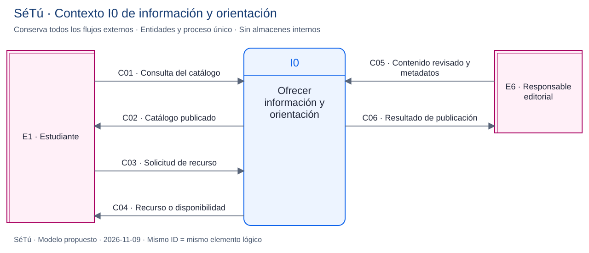
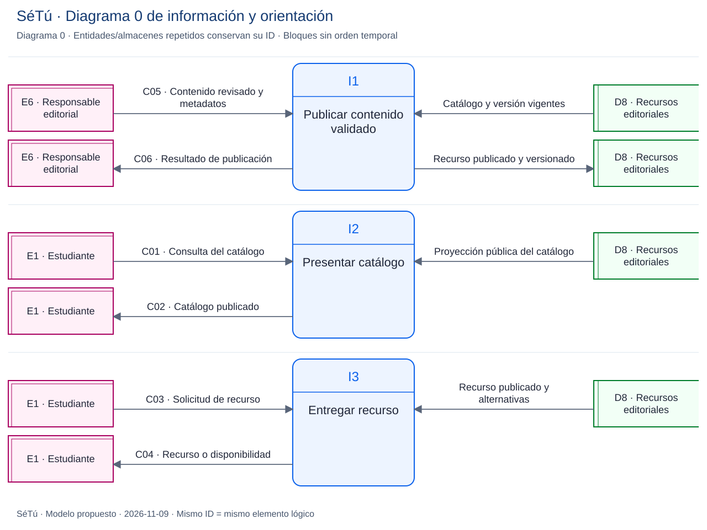

# Espacio Información: origen, alcance e integración

**Revisión:** 2026-11-09. **Decisión de producto confirmada**, reforzada expresamente por el usuario; implementación pendiente. [README](../README.md) · [ADR 0009](decisiones/0009-espacio-informativo-confirmado.md).

## 1. La idea en las sesiones de Meet

Se buscaron menciones pertinentes en las diez minutas/transcripciones de Drive inventariadas en docs/09. La referencia explícita aparece en la [reunión del 9 nov 2026 a las 13:33 CST](https://docs.google.com/document/d/1c6E9dED-tzHSSu2ciC-TWYNtGH2fxLXYpq14DAt0Eeg/edit), sesión registrada de 1:33 a 3:41 p. m. Se revisó el fragmento pertinente y sus acuerdos, sin incorporar al repositorio la transcripción completa o conversaciones ajenas al proyecto.

| Marca de la transcripción | Aporte registrado |
| --- | --- |
| 01:21:40 | La intervención etiquetada **Andrea Juárez** propone tomar como referente un sitio de Netflix sobre temas sensibles: experiencias de personas, cómo se sintieron y cómo afrontaron una situación. |
| 01:22:43 | Plantea artículos y guías prácticas, por ejemplo cómo contar una situación a un adulto o buscar otra ayuda si no se recibe apoyo. Informarse debe ser posible antes de decidir reportar. |
| 01:23:49 | Explica que se puede leer mientras se espera al psicólogo, o informarse aunque no se quiera recibir atención; busca acompañar y disminuir la sensación de estar solo. |
| 01:24:44–01:25:42 | El grupo aclara que se trata de información disponible, no de actividades obligatorias. Se mencionan artículos profesionales de Flo como otro ejemplo y dos espacios diferenciados: información y chat. |
| 01:26:40–01:27:15 | José Alfredo solicita el referente visual y, con Aaron, plantea adaptación móvil por edades; se menciona explicar el acoso con videos sencillos o artículos comprensibles para menores. |

El bloque de acuerdos de esa reunión registra la sección informativa y el enfoque híbrido de reportes e información como **acordados**, y encarga actualizar diseño/documentación. El [Resumen General y Avance](https://docs.google.com/document/d/1aKKx9jfSYpSilB3DdTapQAnF8TMX6NkWiBDbxQoIf4g/edit), actualizado al 9 nov a las 4:12 p. m. en el corte consultado, lo recoge con testimonios en video, artículos y guías, incluso sin reportar. «Incorporada» en el resumen se interpreta como incorporación al producto definido: no prueba código Flutter implementado.

**Atribución:** la etiqueta de la nota automática es Andrea Juárez; el equipo registra a Andrea Nicole Juárez Díaz. La transcripción contiene además menciones a Nicole en tercera persona, por lo que no se certifica la identidad de cada voz ni se reasigna la intervención a Samantha. Lo verificable para esta decisión son el contenido y el acuerdo del equipo. El usuario confirma ahora la inclusión del espacio en la solución y propuesta.

## 2. Análisis del referente aportado

Se revisaron [Wanna Talk About It?](https://www.wannatalkaboutit.com/), su [sección de salud mental y bienestar](https://www.wannatalkaboutit.com/mental-health/) y la portada en español. El referente organiza orientación por temas, combina piezas audiovisuales con explicaciones y recursos, y ofrece caminos para buscar apoyo. Su propósito informativo y de acompañamiento inspira la organización de SéTú, sin demostrar eficacia clínica de nuestra propuesta.

También se leyó el HTML local aportado, `Netflix Resources _ Find Information, Resources, and Support _ Home.html` (325,175 bytes). Su título y secciones corresponden a la portada: la copia no contiene por sí sola los artículos de todas las páginas temáticas. Se inspeccionó como fuente, sin ejecutar sus scripts o importar cookies, formularios, activos, contactos o proveedores de seguimiento al producto.

Se toma **el patrón de información y orientación**, con marca y contenidos propios/autorizados. No es una integración con una API de Netflix, un servicio clínico de Netflix o una copia de su catálogo. El referente incluye servicios extranjeros: no se trasladan contactos a Nicaragua por estar en español. Flo se registra como comparación de la reunión, sin reproducir sus funcionalidades.

## 3. Qué queda confirmado para SéTú

El apartado **Información** forma parte de la solución junto con solicitudes privadas, escucha humana, seguimiento y campaña. «Híbrido» expresa la combinación de información y atención; no significa que todos los videos funcionen sin internet.

Tiene tres entradas complementarias:

1. **Explorar por curiosidad:** desde bienvenida o inicio, sin reporte, cuenta, caso o QR obligatorio para leer el catálogo público.
2. **Entender lo que se está viviendo o sintiendo:** conocer situaciones, emociones y posibilidades de apoyo, con lenguaje por etapa escolar; no obtener un diagnóstico, puntuación o perfil automático.
3. **Acompañar durante la espera:** desde entrega, seguimiento o conversación pendiente, abrir un recurso y regresar al mismo contexto. Leer no confirma recepción, asigna nivel, acelera atención ni cierra un caso.

Formatos previstos: artículos breves, videos explicativos, testimonios editoriales y guías paso a paso. El estudiante decide qué consultar, detener o abandonar; no tiene que completar una lectura para enviar una alerta o hablar con una persona. Los temas iniciales y su redacción se seleccionan con revisión profesional; acoso, emociones y cómo pedir ayuda son ejes de trabajo, no un catálogo clínico publicado.

No se añaden test de autodiagnóstico, recomendaciones basadas en el chat, clasificación automática, terapia automatizada o publicación de testimonios enviados por estudiantes. Un testimonio editorial no es un caso privado reutilizado como contenido. En desarrollo/demostración solo se usan materiales ficticios identificados o recursos autorizados sin datos de casos reales.

## 4. Recorrido y pantallas

[Fuente editable](diseno/flujos/13-flujo-informacion.mmd).

| Pantalla | Comportamiento definido |
| --- | --- |
| E10 · Información | Catálogo por temas y formatos; título, propósito, etapa escolar orientativa, duración y disponibilidad. Entrada desde E01/E03 y E06/E07/E08. No exige narrar cómo se siente la persona ni crear un caso. |
| E11 · Recurso | Texto, video, testimonio o guía revisados; fuente, revisión y responsable visibles según el recurso; controles, subtítulos/transcripción y salida fácil. Puede ofrecer ir a Ayuda o pedir apoyo voluntariamente. |
| E09 · Ayuda | Directorio/rutas de apoyo con territorio y verificación. Se mantiene diferenciado de la biblioteca educativa y de la conversación humana. |
| E06/E07/E08 · Retorno | Se conserva la operación/caso y su estado real. No reenviar la alerta por volver, no simular profesional disponible y no perder una redacción pendiente. |

Si se elige pedir apoyo, se verifica el contexto escolar cuando sea necesario antes del formulario; consultar información nunca obliga a dar el código. La forma exacta de tarjetas, filtros y búsqueda se prototipa y valida con primaria/secundaria; no se da por aprobado un buscador o recomendador que guarde consultas sensibles.

## 5. Integración técnica propuesta

| Capa | Propuesta para revisión de implementación |
| --- | --- |
| App Flutter/Dart | Widgets nativos para catálogo y lectura; catálogo JSON versionado y recursos empaquetados como opción inicial de demo. No hay módulo implementado por documentarlo. |
| Video | `video_player`, mantenido por Flutter, como candidato para reproducción en la app de archivos autorizados locales o por red. Versión, permisos, formatos y accesibilidad deben verificarse antes de instalar. No autoplay o reproducción de fondo por defecto. |
| Actualización editorial | Recursos publicados y metadatos separados del backend de casos; Supabase como opción futura para catálogo/archivos aprobados. Un catálogo empaquetado no requiere crear un CMS o cuarto panel ahora. |
| Sin internet | Mostrar solo lo realmente empaquetado/descargado y vigente; artículo/transcripción como alternativa prevista. Indicar un video no disponible, sin prometer streaming offline ni transportarlo por mesh. Política de descarga/tamaño/caché por aprobar. |
| Privacidad | La consulta pública no lleva ID de caso, relato, institución o nivel clínico. Evitar historial sensible de lectura y recomendaciones inferidas. Los proveedores externos necesitan revisión antes de embebido/enlace; no instalar los rastreadores del referente. |

Fuentes técnicas: [recursos y JSON en Flutter](https://docs.flutter.dev/ui/assets/assets-and-images), [reproducción de video en Flutter](https://docs.flutter.dev/cookbook/plugins/play-video). La selección y el contrato se amplían en [docs/13](13-recursos-tecnicos.md); ninguna dependencia se instala en este bloque.

Cada recurso propuesto necesita ID/versión, tema, formato, resumen, contenido/ubicación del archivo, etapa escolar y duración orientativas, idioma, autor/fuente, responsable de revisión, fecha/vigencia, derechos de uso y alternativa accesible. Disponibilidad offline es una propiedad comprobable del archivo, no del tema. Un estado editorial publicado no es un estado de caso.

## 6. DFD del contenido editorial

Es un subsistema lógico complementario, independiente del caso y del transporte de alertas. La publicación representa una función autorizada de revisión/distribución, no la existencia de una pantalla CMS o un nuevo acceso público de escritura.

[Contexto editable](diseno/flujos/14-dfd-informacion-contexto.mmd) · [Diagrama 0 editable](diseno/flujos/15-dfd-informacion-logico.mmd).

| Flujo | Frontera conservada en contexto/diagrama 0 | Contenido |
| --- | --- | --- |
| C01 | Estudiante → I0 / I2 | Consulta del catálogo/tema, sin datos del caso o identidad civil. |
| C02 | I0 / I2 → Estudiante | Catálogo de recursos publicados y disponibilidad real. |
| C03 | Estudiante → I0 / I3 | Identificador y versión del recurso solicitado. |
| C04 | I0 / I3 → Estudiante | Recurso público revisado, alternativa accesible o indicación de no disponibilidad. |
| C05 | Responsable editorial → I0 / I1 | Contenido previamente revisado por personas autorizadas, metadatos y permiso de uso. |
| C06 | I0 / I1 → Responsable editorial | Resultado/referencia de publicación o rechazo de validación técnica. |

**D8 · Recursos editoriales** conserva contenidos/versiones y metadatos; es independiente de D2–D4 (casos) y D6–D7 (mesh). I1 publica contenido validado, I2 presenta catálogo e I3 entrega el recurso. La revisión profesional es humana; I1 no valida automáticamente su corrección clínica. Los seis flujos se balancean sin añadir destinos externos. Más método en [docs/12](12-modelado-dfd-kendall.md).

## 7. Aceptación y decisiones pendientes

Debe poder abrirse E10 sin reporte o QR; navegar a texto/video accesible; distinguir descargado de no disponible; pedir ayuda voluntariamente; volver desde la espera conservando operación/estado; y comprobar que lectura/consultas no exponen ni modifican casos. Una maqueta verifica navegación; reproducir/cargar archivos y preservar estado requiere implementación aprobada y pruebas.

La **existencia y finalidad** del apartado están confirmadas. Se decide después el primer catálogo, revisión profesional, derechos, diseño por edad, reproductor/versiones, distribución y política offline. El corte de demo debe representar esta parte de la solución con material de ejemplo identificado y declarar cualquier tramo simulado; no se presenta como catálogo clínico operativo o módulo ya programado.
