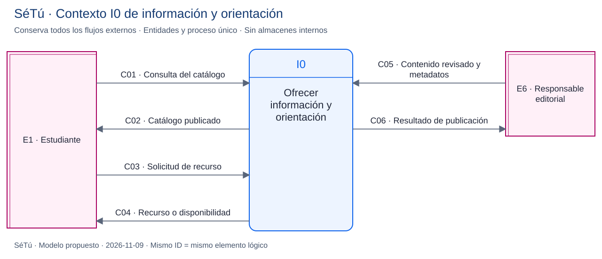
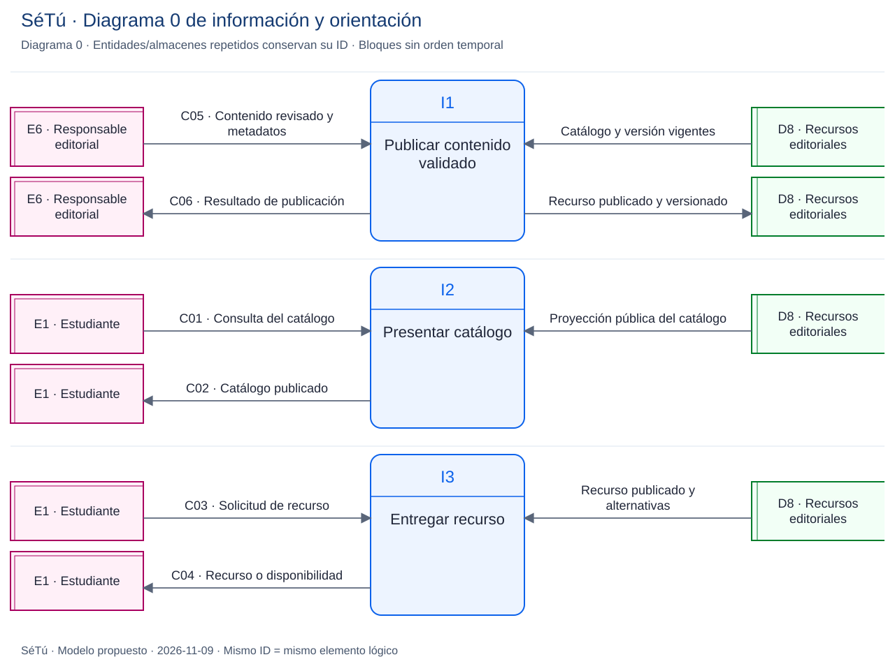

# Espacio Información: origen, alcance e integración

**Revisión:** 2026-11-16. **Decisión de producto confirmada**; demo E10/E11 implementada con aprobación del usuario, pendiente de publicación editorial. [README](../README.md) · [ADR 0009](decisiones/0009-espacio-informativo-confirmado.md).

## 1. La idea en las sesiones de Meet

Se buscaron menciones pertinentes en las diez minutas/transcripciones de Drive inventariadas en docs/09. La referencia explícita aparece en la [reunión del 9 nov 2026 a las 13:33 CST](https://docs.google.com/document/d/1c6E9dED-tzHSSu2ciC-TWYNtGH2fxLXYpq14DAt0Eeg/edit), sesión registrada de 1:33 a 3:41 p. m. Se revisó el fragmento pertinente y sus acuerdos, sin incorporar al repositorio la transcripción completa o conversaciones ajenas al proyecto.

| Marca de la transcripción | Aporte registrado |
| --- | --- |
| 01:21:40 | La intervención etiquetada **Andrea Juárez** propone tomar como referente un sitio de Netflix sobre temas sensibles: experiencias de personas, cómo se sintieron y cómo afrontaron una situación. |
| 01:22:43 | Plantea artículos y guías prácticas, por ejemplo cómo contar una situación a un adulto o buscar otra ayuda si no se recibe apoyo. Informarse debe ser posible antes de decidir reportar. |
| 01:23:49 | Explica que se puede leer mientras se espera al psicólogo, o informarse aunque no se quiera recibir atención; busca acompañar y disminuir la sensación de estar solo. |
| 01:24:44–01:25:42 | El grupo aclara que se trata de información disponible, no de actividades obligatorias. Se mencionan artículos profesionales de Flo como otro ejemplo y dos espacios diferenciados: información y chat. |
| 01:26:40–01:27:15 | José Alfredo solicita el referente visual y, con Aaron, plantea adaptación móvil por edades; se menciona explicar el acoso con videos sencillos o artículos comprensibles para menores. |

El bloque de acuerdos de esa reunión registra la sección informativa y el enfoque híbrido de reportes e información como **acordados**, y encarga actualizar diseño/documentación. El [Resumen General y Avance](https://docs.google.com/document/d/1aKKx9jfSYpSilB3DdTapQAnF8TMX6NkWiBDbxQoIf4g/edit), actualizado al 9 nov a las 4:12 p. m. en el corte consultado, lo recoge con testimonios en video, artículos y guías, incluso sin reportar. «Incorporada» en el resumen se interpreta como incorporación al producto definido: no prueba código Flutter implementado.

**Atribución:** la etiqueta de la nota automática es Andrea Juárez; el equipo registra a Andrea Nicole Juárez Díaz. La transcripción contiene además menciones a Nicole en tercera persona, por lo que no se certifica la identidad de cada voz ni se reasigna la intervención a Samantha. Lo verificable para esta decisión son el contenido y el acuerdo del equipo. El usuario confirma ahora la inclusión del espacio en la solución y propuesta.

## 2. Análisis del referente aportado

Se revisaron [Wanna Talk About It?](https://www.wannatalkaboutit.com/), su [sección de salud mental y bienestar](https://www.wannatalkaboutit.com/mental-health/) y la portada en español. El referente organiza orientación por temas, combina piezas audiovisuales con explicaciones y recursos, y ofrece caminos para buscar apoyo. Su propósito informativo y de acompañamiento inspira la organización de SéTú, sin demostrar eficacia clínica de nuestra propuesta.

También se leyó el HTML local aportado, `Netflix Resources _ Find Information, Resources, and Support _ Home.html` (325,175 bytes). Su título y secciones corresponden a la portada: la copia no contiene por sí sola los artículos de todas las páginas temáticas. Se inspeccionó como fuente, sin ejecutar sus scripts o importar cookies, formularios, activos, contactos o proveedores de seguimiento al producto.

Se toma **el patrón de información y orientación**, con marca y contenidos propios/autorizados. No es una integración con una API de Netflix, un servicio clínico de Netflix o una copia de su catálogo. El referente incluye servicios extranjeros: no se trasladan contactos a Nicaragua por estar en español. Flo se registra como comparación de la reunión, sin reproducir sus funcionalidades.

## 3. Qué queda confirmado para SéTú

El apartado **Información** forma parte de la solución junto con solicitudes privadas, escucha humana, seguimiento y campaña. «Híbrido» expresa la combinación de información y atención; no significa que todos los videos funcionen sin internet.

Tiene tres entradas complementarias:

1. **Explorar por curiosidad:** desde bienvenida o inicio, sin reporte, cuenta, caso o QR obligatorio para leer el catálogo público.
2. **Entender lo que se está viviendo o sintiendo:** conocer situaciones, emociones y posibilidades de apoyo, con lenguaje por etapa escolar; no obtener un diagnóstico, puntuación o perfil automático.
3. **Acompañar durante la espera:** desde entrega, seguimiento o conversación pendiente, abrir un recurso y regresar al mismo contexto. Leer no confirma recepción, asigna nivel, acelera atención ni cierra un caso.

Formatos previstos: artículos breves, videos explicativos, testimonios editoriales y guías paso a paso. El estudiante decide qué consultar, detener o abandonar; no tiene que completar una lectura para enviar una alerta o hablar con una persona. Los temas iniciales y su redacción se seleccionan con revisión profesional; acoso, emociones y cómo pedir ayuda son ejes de trabajo, no un catálogo clínico publicado.

No se añaden test de autodiagnóstico, recomendaciones basadas en el chat, clasificación automática, terapia automatizada o publicación de testimonios enviados por estudiantes. Un testimonio editorial no es un caso privado reutilizado como contenido. En desarrollo/demostración solo se usan materiales ficticios identificados o recursos autorizados sin datos de casos reales.

## 4. Recorrido y pantallas

[Fuente editable](diseno/flujos/13-flujo-informacion.mmd).

| Pantalla | Comportamiento definido |
| --- | --- |
| E10 · Información | Catálogo por temas y formatos; título, propósito, etapa escolar orientativa, duración y disponibilidad. Entrada desde E01/E03 y E06/E07/E08. No exige narrar cómo se siente la persona ni crear un caso. |
| E11 · Recurso | Texto, video, testimonio o guía revisados; fuente, revisión y responsable visibles según el recurso; controles, subtítulos/transcripción y salida fácil. Puede ofrecer ir a Ayuda o pedir apoyo voluntariamente. |
| E09 · Ayuda | Directorio/rutas de apoyo con territorio y verificación. Se mantiene diferenciado de la biblioteca educativa y de la conversación humana. |
| E06/E07/E08 · Retorno | Se conserva la operación/caso y su estado real. No reenviar la alerta por volver, no simular profesional disponible y no perder una redacción pendiente. |

Si se elige pedir apoyo, se verifica el contexto escolar cuando sea necesario antes del formulario; consultar información nunca obliga a dar el código. La forma exacta de tarjetas, filtros y búsqueda se prototipa y valida con primaria/secundaria; no se da por aprobado un buscador o recomendador que guarde consultas sensibles.

## 5. Integración técnica y catálogo inicial

| Capa | Propuesta para revisión de implementación |
| --- | --- |
| App Flutter/Dart | Demo Flutter implementada: catálogo tipado local en `info_catalog.dart`, Biblioteca con búsqueda/filtros, Rutas y lectores. Textos e ilustraciones empaquetados; sin backend editorial. |
| Video | Los videos del catálogo se abren fuera de SéTú mediante el canal nativo Android `dev.cureando.app/links`, con HTTPS y hosts permitidos. Resumen adaptado y puntos clave disponibles sin internet; no se promete transcripción completa. No se empaquetan videos, se simula reproducción ni se instala `video_player`. |
| Actualización editorial | Recursos publicados y metadatos separados del backend de casos; Supabase como opción futura para catálogo/archivos aprobados. Un catálogo empaquetado no requiere crear un CMS o cuarto panel ahora. |
| Sin internet | Mostrar solo lo realmente empaquetado/descargado y vigente; artículo/transcripción como alternativa prevista. Indicar un video no disponible, sin prometer streaming offline ni transportarlo por mesh. Política de descarga/tamaño/caché por aprobar. |
| Privacidad | La consulta pública no lleva ID de caso, relato, institución o nivel clínico. Evitar historial sensible de lectura y recomendaciones inferidas. Los proveedores externos necesitan revisión antes de embebido/enlace; no instalar los rastreadores del referente. |

Fuentes técnicas: [recursos y JSON en Flutter](https://docs.flutter.dev/ui/assets/assets-and-images), [reproducción de video en Flutter](https://docs.flutter.dev/cookbook/plugins/play-video). La selección y el contrato se amplían en [docs/13](13-recursos-tecnicos.md); ninguna dependencia se instala en este bloque.

Cada recurso propuesto necesita ID/versión, tema, formato, resumen, contenido/ubicación del archivo, etapa escolar y duración orientativas, idioma, autor/fuente, responsable de revisión, fecha/vigencia, derechos de uso y alternativa accesible. Disponibilidad offline es una propiedad comprobable del archivo, no del tema. Un estado editorial publicado no es un estado de caso.

## 6. DFD del contenido editorial

Es un subsistema lógico complementario, independiente del caso y del transporte de alertas. La publicación representa una función autorizada de revisión/distribución, no la existencia de una pantalla CMS o un nuevo acceso público de escritura.

[Contexto editable](diseno/flujos/14-dfd-informacion-contexto.mmd) · [Diagrama 0 editable](diseno/flujos/15-dfd-informacion-logico.mmd).

| Flujo | Frontera conservada en contexto/diagrama 0 | Contenido |
| --- | --- | --- |
| C01 | Estudiante → I0 / I2 | Consulta del catálogo/tema, sin datos del caso o identidad civil. |
| C02 | I0 / I2 → Estudiante | Catálogo de recursos publicados y disponibilidad real. |
| C03 | Estudiante → I0 / I3 | Identificador y versión del recurso solicitado. |
| C04 | I0 / I3 → Estudiante | Recurso público revisado, alternativa accesible o indicación de no disponibilidad. |
| C05 | Responsable editorial → I0 / I1 | Contenido previamente revisado por personas autorizadas, metadatos y permiso de uso. |
| C06 | I0 / I1 → Responsable editorial | Resultado/referencia de publicación o rechazo de validación técnica. |

**D8 · Recursos editoriales** conserva contenidos/versiones y metadatos; es independiente de D2–D4 (casos) y D6–D7 (mesh). I1 publica contenido validado, I2 presenta catálogo e I3 entrega el recurso. La revisión profesional es humana; I1 no valida automáticamente su corrección clínica. Los seis flujos se balancean sin añadir destinos externos. Más método en [docs/12](12-modelado-dfd-kendall.md).

## 7. Aceptación y decisiones pendientes

Debe poder abrirse E10 sin reporte o QR; navegar a texto/video accesible; distinguir descargado de no disponible; pedir ayuda voluntariamente; volver desde la espera conservando operación/estado; y comprobar que lectura/consultas no exponen ni modifican casos. Una maqueta verifica navegación; reproducir/cargar archivos y preservar estado requiere implementación aprobada y pruebas.

La **existencia y finalidad** del apartado y la integración del catálogo inicial están confirmadas. Se integran 21 recursos verificados de UNICEF/MINED en seis temas y cuatro rutas. La revisión profesional, derechos, accesibilidad, adecuación por edad y distribución editorial futura siguen pendientes; no se presenta como catálogo clínico operativo. Detalle y lista completa de fuentes en [ADR 0026](decisiones/0026-catalogo-inicial-con-fuentes-unicef-mined.md).

## 8. Catálogo inicial E10/E11 aprobado (16 nov 2026)

- `/informacion` abre Biblioteca y Rutas sin código ni sesión; `/informacion/recurso/:id` permite leer recursos. Desde Inicio se usan `/inicio/recurso/:id`. La navegación conserva la selección del catálogo al volver del lector.
- Fuente editorial de desarrollo: `.content/catalogo_informacion.json`, verificada el 16 de noviembre de 2026. Se copian a constantes Dart **solo 21 recursos con `verified == true`**, excluyendo los cuatro restantes. El JSON no se lee en ejecución ni se empaqueta.
- Temas: Acoso escolar, Ansiedad, Depresión, Ciberacoso, Emociones y Apoyo. Cuatro rutas activas (los cuatro primeros temas), cada una con dos recursos y una pregunta de cierre A/B/C con feedback por opción. Todas las referencias actuales son verificadas.
- Inicio abre «Qué es el acoso escolar y cómo se ve» y «Cómo cuidar tu salud mental», conservando sus ilustraciones. Lector con título, organización, resumen, tarjetas de puntos clave, fuente (organización y URL) y botón «Ver fuente original» o «Ver video».
- **Resúmenes adaptados por el equipo SéTú a partir de la fuente; no reemplazan la fuente original.** Modal: «Contenido de UNICEF/MINED; adaptado para estudiantes de Nicaragua»; «Verificado el 16 de noviembre de 2026 · Pendiente revisión profesional (Psicología)»; «Equipo SéTú (Bugñuelitos, UAM)». La verificación editorial no certifica revisión profesional ni aval de UNICEF/MINED.
- En ansiedad/depresión se muestra antes de los puntos clave: «Si te sentís en peligro o pensás en hacerte daño, hablá ya con una persona adulta de confianza o entrá a Ayuda», con botón a esa pestaña. Se conservan los contactos existentes.
- Los videos se abren **fuera de la app** y requieren internet; el resumen adaptado se puede leer sin conexión. No hay reproductor simulado, descarga de video ni dependencia nueva. Las notas del JSON advierten que los tres videos de Facebook no pudieron reproducirse: sus puntos se basan en descripciones visibles; revisar los audiovisuales completos antes de publicación operativa.
- La guía socioemocional del MINED **solo se enlaza**; no se reproduce ni distribuye el PDF. Se muestra el resumen adaptado aprobado, con fuente, sin copiar páginas del documento.
- +5 XP por primera lectura confirmada y +10 XP una sola vez por cierre correcto de cada ruta, independiente de la Pregunta del día. Persistencia cifrada v1 compatible con registros anteriores; `acoso` conserva su identificador y los XP previos no se pierden. Repetir lecturas en otro día solo registra actividad. Abrir enlaces, pedir apoyo o enviar casos no concede XP.
- Revisión profesional (Psicología), derechos, accesibilidad, adecuación por edad y pruebas en dispositivo pendientes. No se cambia la operación de casos ni se habilitan casos reales.

La [lista completa de las 21 fuentes y el criterio editorial](decisiones/0026-catalogo-inicial-con-fuentes-unicef-mined.md) se registra en ADR 0026: UNICEF (guías de distintos países y videos UNICEF Nicaragua/Costa Rica) y documentos MINED Nicaragua, incluida la guía socioemocional con World Vision Nicaragua.
