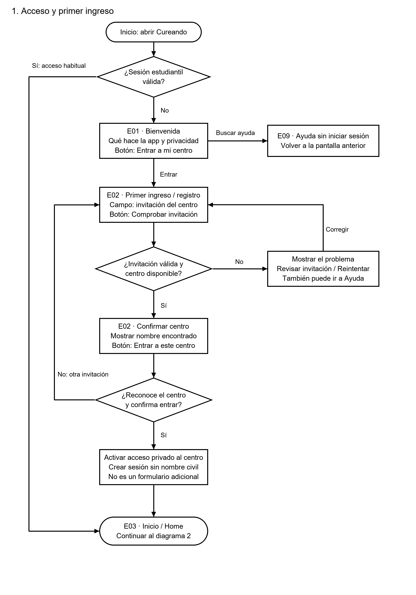
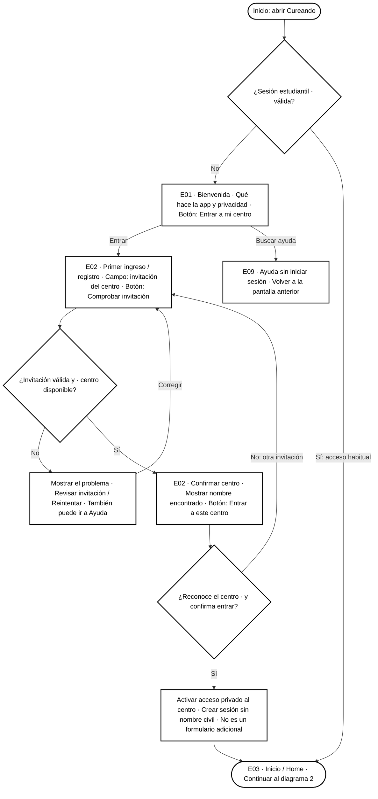
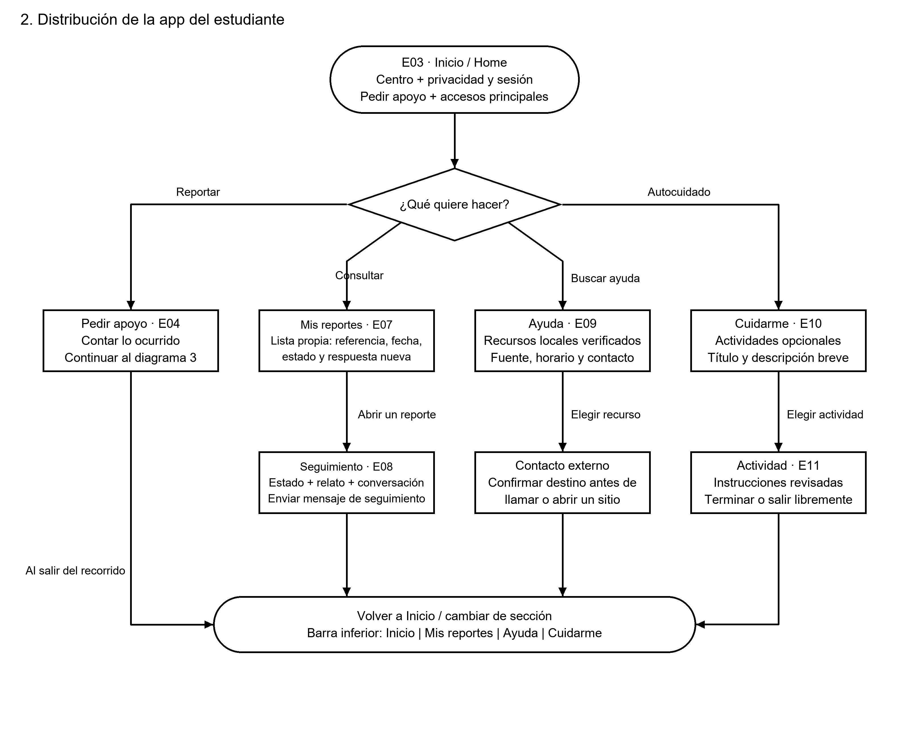
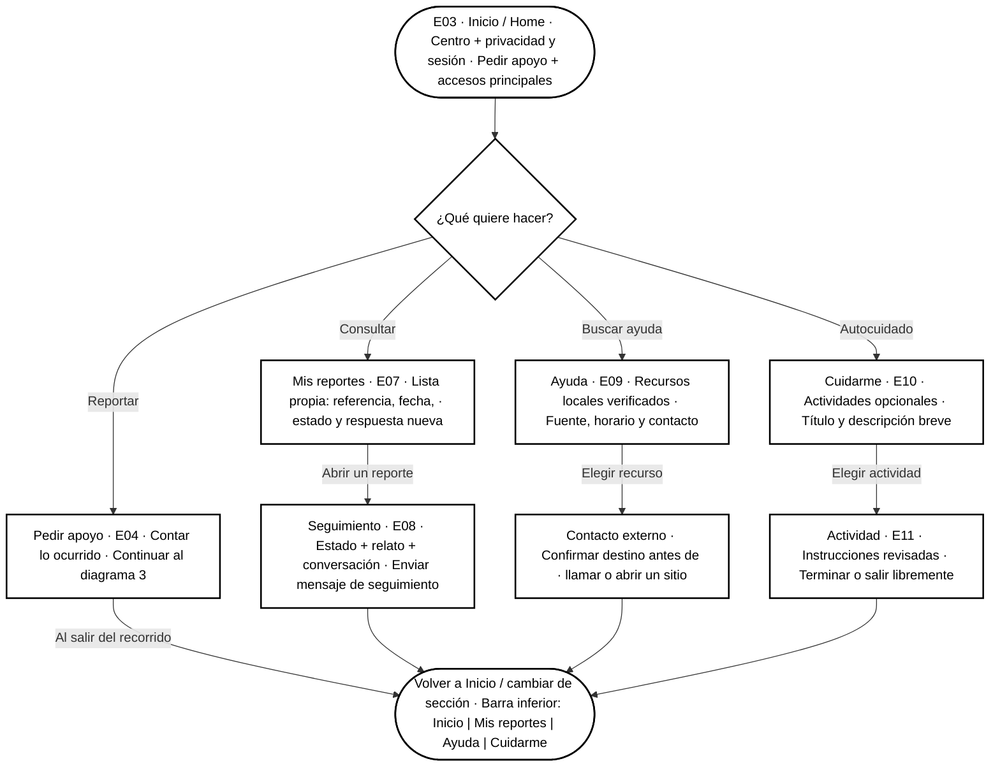
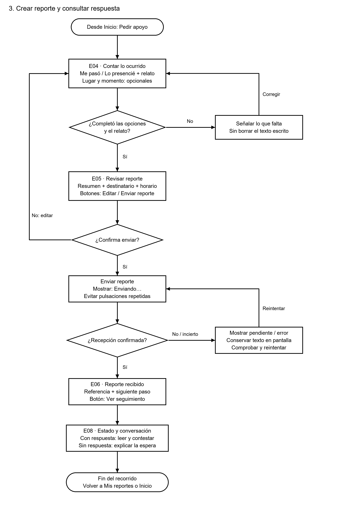
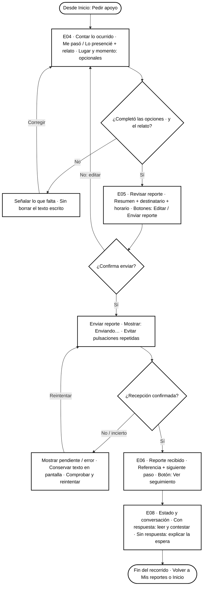
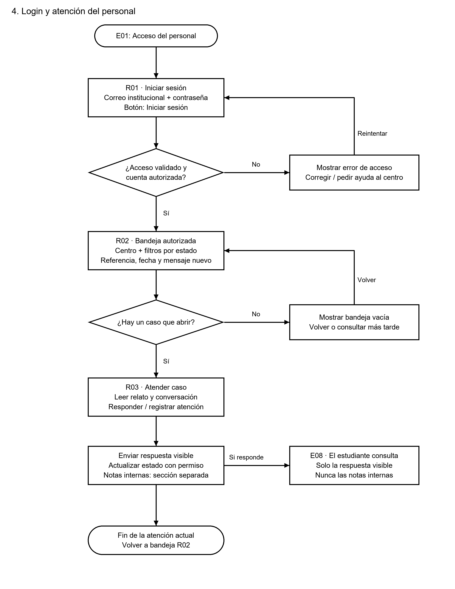
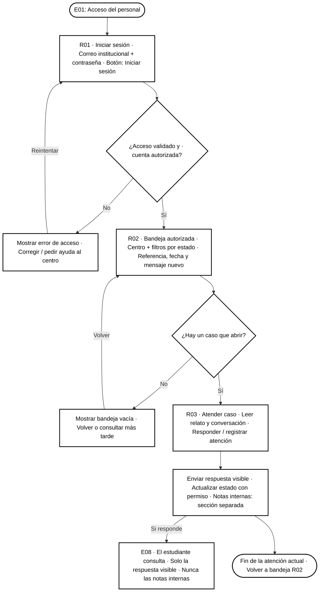

# Cureando — Diagramas de flujo para diseño

Estado: propuesta. Estos diagramas describen pantallas y navegación, no estructura de carpetas.

[Abrir versión visual](index.html). Hay imágenes PNG para compartir y SVG para escalar sin perder calidad.

El acceso estudiantil propuesto es por invitación y sesión privada, no por correo/contraseña; recuperación pendiente. El personal usa cuentas asignadas. Ver [contenido de cada pantalla](../pantallas-explicadas.md).

## 1. Acceso y primer ingreso

Propuesta actual: registro por invitación, sin correo ni contraseña del estudiante. Recuperación pendiente.

## 2. Distribución de la app del estudiante

Esta es la distribución de pantallas y navegación para diseño; no representa carpetas del código.

## 3. Crear reporte y consultar respuesta

Si el envío no está confirmado, no mostrar éxito. Comprobar o reintentar sin duplicar el caso.

## 4. Login y atención del personal

Cuenta asignada por la institución. No hay registro público del personal ni acceso a otros centros.

