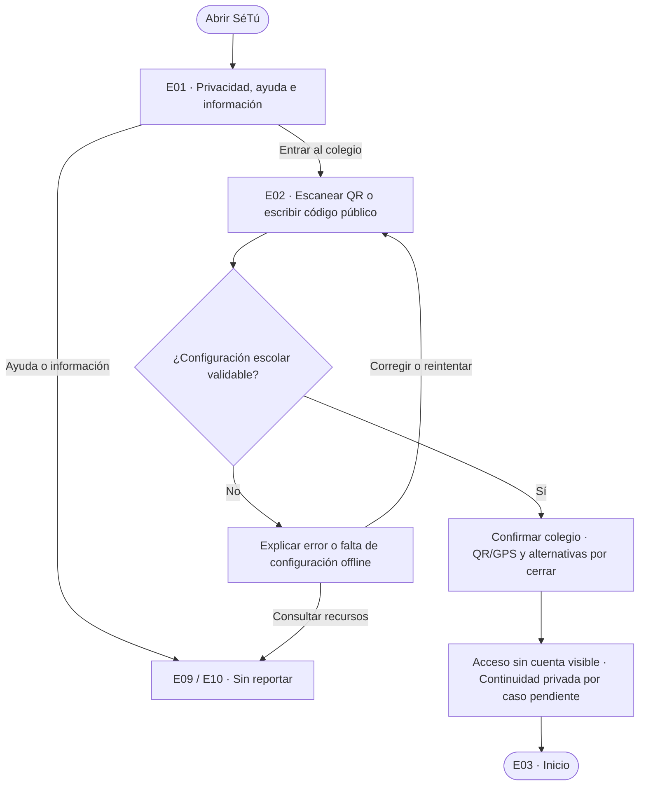
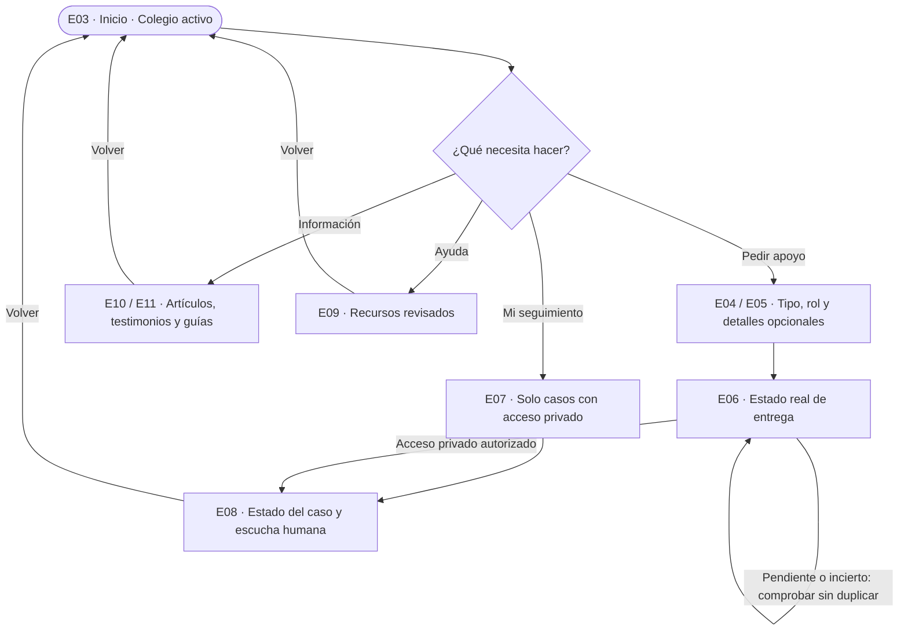
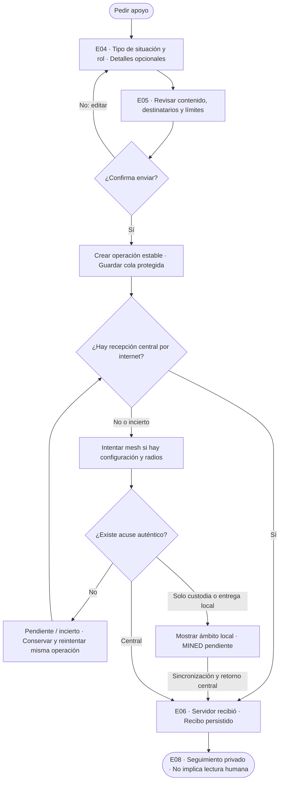
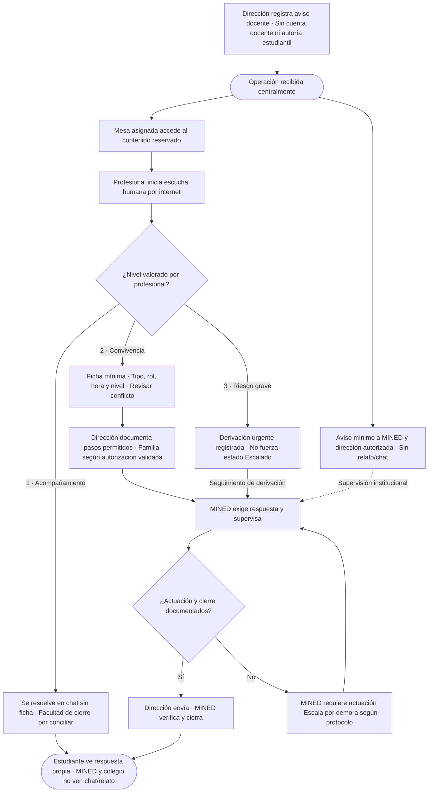
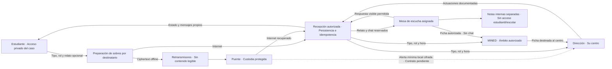
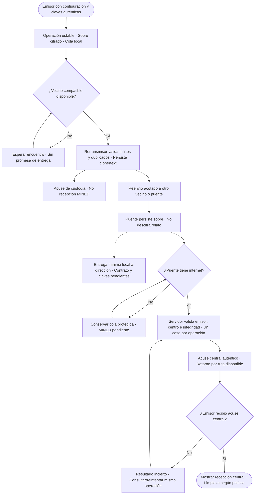
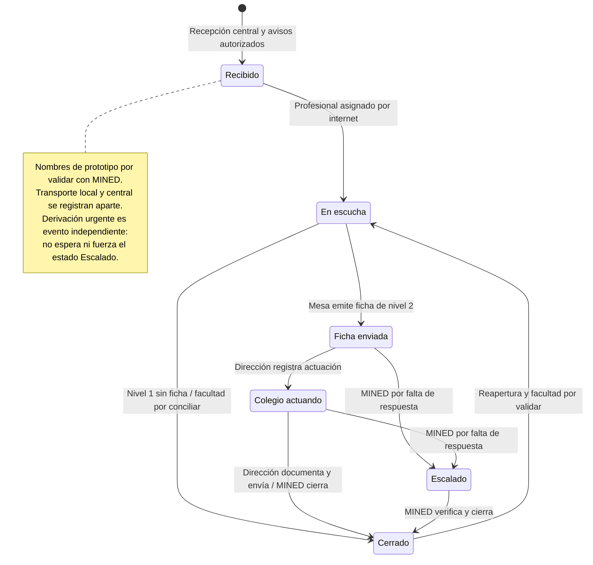

# Diagramas vigentes de SéTú

**Revisión:** 2026-11-09. Producto según ADR 0005; contratos y transiciones como propuestas de ADR 0006. No son evidencia de implementación. [Especificación técnica](../../../README.md) · [Pantallas](../../08-especificacion-funcional-setu.md) · [Datos y mesh](../../10-flujo-datos-y-red-mesh.md).

Las fuentes Mermaid de esta carpeta son la versión vigente. La entrega local offline conserva la indicación de contrato pendiente; no concede acceso al chat a dirección o puente. Los seis nombres se usan como propuesta de prototipo y necesitan validación institucional. La derivación urgente no fuerza Escalado, que el manual MINED reserva a falta de respuesta. MINED y dirección nunca ven chat/relato; el chat necesita internet.

Las imágenes PNG/SVG y los HTML generados antes de esta revisión son históricos y no deben usarse para implementar. El generador Python conserva el modelo anterior y no debe ejecutarse sobre estas fuentes. Su actualización y la regeneración visual requieren aprobación del cambio de código; se solicitó por separado. Los diagramas actuales pueden leerse aquí con un visor Markdown compatible con Mermaid o desde sus archivos `.mmd`.

## Acceso sin cuentas

[Fuente editable](01-acceso.mmd)

## Navegación estudiantil

[Fuente editable](02-distribucion.mmd)

## Solicitud y confirmación de entrega

[Fuente editable](03-reporte.mmd)

## Escucha, MINED y dirección

[Fuente editable](04-personal.mmd)

## Flujo de datos y destinatarios

[Fuente editable](05-datos.mmd)

## Transporte mesh y sincronización

[Fuente editable](06-mesh.mmd)

## Estados del caso

[Fuente editable](07-estados.mmd)

