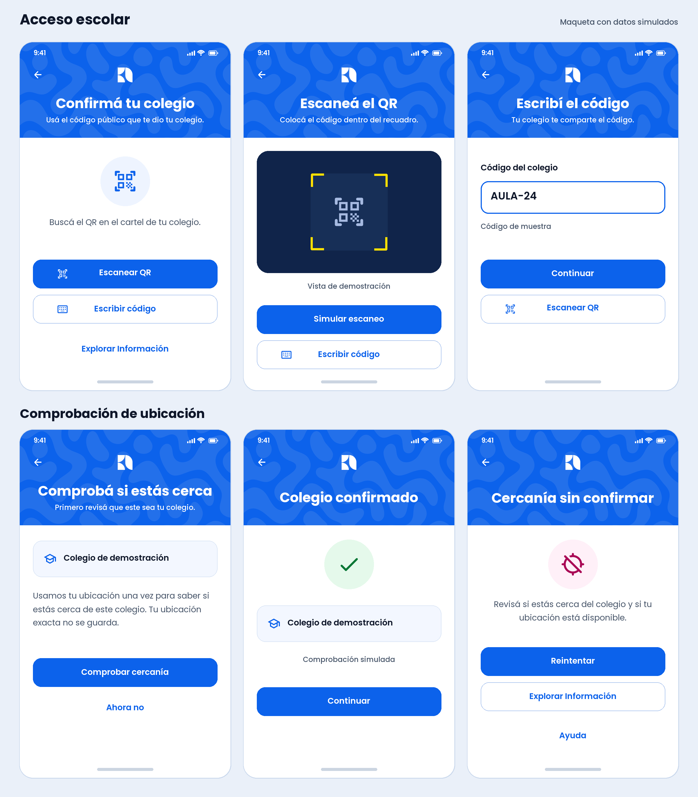

# E02 · Demostración de acceso escolar

**12 de noviembre de 2026.** Maqueta aprobada e integrada como demostración. Usa el patrón, el isotipo y la tipografía de la bienvenida de SéTú.

## Recorrido de la prueba

| Vista | Acción y resultado |
| --- | --- |
| Confirmá tu colegio | Desde la bienvenida, elegir **Escanear QR** o **Escribir código**. Información también queda accesible desde esta entrada. |
| Escaneá el QR | Mostrar el recuadro y ofrecer **Simular escaneo**. La alternativa manual sigue visible. |
| Escribí el código | Campo editable. `AULA-24` simula cercanía confirmada y `AULA-00` deja la cercanía sin confirmar. **Continuar** abre la misma revisión del colegio que el QR. El formato definitivo del código sigue por definir. |
| Comprobá si estás cerca | Mostrar el colegio identificado por el código. Explicar que la ubicación se usaría una vez para comprobar cercanía a ese colegio y que la ubicación exacta no se guardaría. El estudiante decide cuándo tocar **Comprobar cercanía**. **Ahora no** vuelve a la entrada escolar. |
| Colegio confirmado | Mostrar el resultado de muestra y una continuación de demostración al inicio estudiantil. |
| Cercanía sin confirmar | Mostrar un ejemplo de comprobación fallida con **Reintentar**, **Explorar Información** y **Ayuda**. La prueba puede representar distancia o ubicación no disponible. |

La integración usa un colegio ficticio, un visor de muestra y resultados en memoria. Los permisos de Android, la lectura de cámara, los datos de ubicación y la validación real del código quedan para un bloque propio. La cercanía futura solo describe la proximidad al colegio asociado al código. El radio, la precisión, el primer ingreso offline y el acceso fuera del centro siguen por resolver. [Especificación funcional](../08-especificacion-funcional-setu.md) · [Arquitectura del acceso](../02-arquitectura.md) · [Permisos de ubicación Android](https://developer.android.com/develop/sensors-and-location/location/permissions).

## Transiciones, barra de estado y capturas locales

- **Transiciones.** Fundido y desplazamiento corto al navegar entre pantallas de estudiante. Duración de 260 ms al avanzar y 220 ms al volver. Con movimiento reducido, los cambios son inmediatos. [Preferencia de movimiento en Flutter](https://api.flutter.dev/flutter/widgets/MediaQuery/disableAnimationsOf.html).
- **Barra de estado.** El patrón azul se prolonga debajo de la hora y las notificaciones en E01 y E02. El margen del sistema protege los controles táctiles. [Dibujo bajo las barras del sistema en Android](https://developer.android.com/develop/ui/views/layout/edge-to-edge).
- **Capturas para revisión de diseño.** Desde `apps/mobile/`, `flutter run --dart-define=SETU_DESIGN_CAPTURE=true` habilita las capturas durante una ejecución de depuración. La compilación habitual arranca con protección y Android rechaza desactivarla en compilaciones que carecen de la marca de depuración. [Ejecución Android](../../apps/mobile/README.md) · [Protección de pantalla en Android](https://developer.android.com/security/fraud-prevention/activities#flag_secure).

El usuario aprobó la maqueta de acceso escolar y pidió transiciones suaves en el chat. [Decisión de implementación](../decisiones/0011-acceso-escolar-demostracion.md).

## Siguiente bloque · Casillas, cámara y ubicación del dispositivo

**Propuesta para aprobación.** La captura aportada por el usuario define el formato visual de ingreso. El corte publicado todavía usa el campo y los resultados simulados descritos arriba.

- **Código de seis caracteres.** Mostrar seis casillas, con foco visible y teclado único. Permitir pegar y corregir el código completo. Para la demostración, `AULA24` identifica un centro ficticio. Al pegar el ejemplo anterior, `AULA-24`, se ignora el guion. El código se acepta tanto por teclado como por QR, con el mismo catálogo de prueba.
- **Cámara real.** Abrirla cuando el usuario elija **Escanear el QR del colegio**. La cámara se cierra al reconocer un código válido, al cambiar a entrada manual o al salir de la pantalla. Si el permiso se deniega, queda disponible la entrada manual. Probar `mobile_scanner` con el lector de Android incluido en el APK. [Documentación de mobile_scanner](https://pub.dev/packages/mobile_scanner#android).
- **Cercanía real.** Al tocar **Comprobar cercanía**, pedir ubicación en primer plano y comparar una lectura actual con el punto público asociado al código. El QR contiene solo el código y la ubicación del colegio proviene de la configuración de prueba. Calcular el resultado en el teléfono y descartar la lectura, sin guardarla ni enviarla. Usar tres resultados según la distancia y la precisión: cercanía confirmada, fuera de la zona o sin confirmar. Un radio inicial de 150 m sería un parámetro de la demostración, sujeto a la prueba física. Se propone la UAM como lugar de la presentación o el punto público que indique el usuario. [Ubicación del campus](https://uamvirtual.uam.edu.ni/) · [Permisos de ubicación en Android](https://developer.android.com/develop/sensors-and-location/location/permissions) · [Documentación de geolocator](https://pub.dev/packages/geolocator).
- **Capturas temporales.** El APK de presentación permitirá capturas y grabación para el ensayo, el diseño y la presentación. Registrar la excepción en la bitácora del APK y volver a la configuración protegida al terminar la presentación. El APK local actual con `SETU_DESIGN_CAPTURE=true` ya permite capturar la interfaz simulada. [Notas del APK](../../apps/mobile/README.md#capturas-temporales-para-la-presentación).

Pruebas previstas en Android: pegar y corregir un código, escanear un QR de muestra, verificar lectura cerca y lejos, denegar permisos y comprobar la recuperación. Revisar la lectura QR sin red y qué ocurre si el teléfono tarda en obtener ubicación. La frase «Funciona aunque no haya internet» se ajustará al resultado de esas pruebas. El código identifica el centro de prueba y la cercanía no acredita matrícula.
