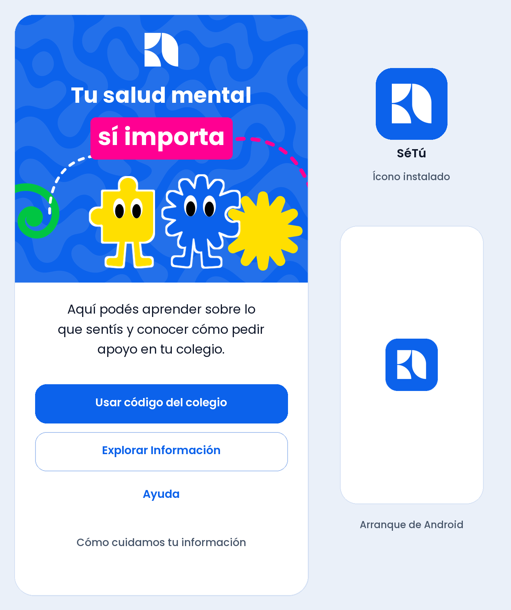

# Plan de arranque y wireframe de bienvenida de SéTú

**12 de noviembre de 2026 · Propuesta para revisión del equipo Bugñuelitos.** Este primer bloque prueba cómo se entiende la entrada estudiantil y cómo se traslada la identidad aprobada a Android. Se revisa como pieza independiente del recorrido integrado previsto para el 17 de noviembre.

## Punto de partida

- **Producto acordado.** Estudiantes de 3.º a 11.º grado, con primera fase en colegios públicos del casco urbano de Managua. La entrada escolar usa el código público del colegio. Información es un destino propio, accesible antes del QR y durante la espera de atención. Ayuda, Información y la solicitud de apoyo cumplen funciones distintas. [Producto](../01-producto.md) · [ADR 0005](../decisiones/0005-alineacion-con-decisiones-del-equipo-drive.md) · [ADR 0009](../decisiones/0009-espacio-informativo-confirmado.md).
- **Base disponible.** La ruta `/` de Flutter abre la pantalla de verificación M1. Ya existen tema Material 3, Poppins empaquetada, `go_router`, ajustes de lectura y protección de pantalla. M1 conserva almacenamiento cifrado y contratos locales del modelo anterior. E01–E11, paneles, backend conectado y red mesh siguen pendientes de implementación. [Código de entrada](../../apps/mobile/lib/app.dart) · [Corte M1](../../apps/mobile/README.md).
- **Fuente visual.** Se revisó el manual de Drive de 32 páginas. La copia local difiere en cinco páginas en la comparación de render y Drive tiene prioridad. El SVG azul versionado coincide con `logos-22.svg` al ignorar el salto de línea final. La copia de trabajo contiene correcciones locales en el tema y el lanzador Android que aplican la paleta de marca. Su revisión y eventual incorporación a Git corresponden al bloque visual de código. [Manual final](https://drive.google.com/file/d/11vE2_hviWBnT79giw6Y8mgofxUckyae6/view) · [Guía de diseño](../06-guia-diseno.md) · [Logo azul](setu-logo-azul.svg).
- **Referente aportado.** La captura de Andrea App muestra una bienvenida con una figura dominante, un saludo breve y bastante espacio en blanco. Para SéTú se propone aprovechar esa jerarquía y dar acceso visible a Información, Ayuda y la entrada escolar. El manual de SéTú define los recursos, la paleta y las reglas de aplicación. [Investigación de referentes](../05-investigacion-y-skills.md).

## Primer wireframe · E01 Bienvenida y privacidad

El usuario eligió en el formulario del chat una bienvenida basada en los artes publicitarios, los dos personajes en una composición estática y el isotipo blanco sobre azul en el ícono instalado y en el arranque. La propuesta usa el patrón, los personajes y los motivos de las capas originales de **Redes 3**, y el mensaje de **Redes 1**. Se añadió un contorno blanco a los personajes, siguiendo el tratamiento de Redes 1 y 2, para que el personaje azul se distinga sobre el fondo. [Originales de campaña](https://drive.google.com/drive/folders/14-7yEp0lRQgI02GkWlXZOEl15beNjYby) · [Boceto anterior](wireframe-e01-bienvenida.png).

| Elemento | Propuesta para revisar |
| --- | --- |
| Composición | Una pantalla desplazable, con cabecera azul de campaña, isotipo blanco centrado y los dos personajes estáticos. La zona clara reúne descripción, acciones y enlace de privacidad. Los motivos quedan fuera del área protegida del isotipo. |
| Texto inicial | **Tu salud mental sí importa**. «Aquí podés aprender sobre lo que sentís y conocer cómo pedir apoyo en tu colegio». Probar el voseo y la comprensión del texto en primaria y secundaria con la misma estructura inicial. |
| Usar código del colegio | Acción principal → E02. En la prueba abre una vista identificada como demostración, con el propósito del QR y la entrada manual representados. El escáner, la validación y la solicitud de permisos quedan para el bloque de acceso escolar. |
| Explorar Información | Acción secundaria → vista de muestra E10. Explica qué se encontrará en el espacio y permite volver. Se puede abrir directamente desde E01. El catálogo, lector E11 y distribución de contenido se aprueban como bloque propio. |
| Ayuda | Acceso visible → vista de muestra E09 con retorno a E01. Los contactos se incorporan cuando estén verificados por territorio, fecha, fuente y responsable. |
| Cómo cuidamos tu información | Abre un panel legible con cierre y retorno a E01. Texto para revisar con Psicología. «Si pedís apoyo, solo vos y el equipo de escucha asignado pueden leer tu relato y tu chat. El MINED y tu colegio reciben datos limitados para dar seguimiento. Lo que escribás puede revelar quién sos». |

**Identidad.** Usar `#0C62EB` en la cabecera y la acción principal, `#FF0092` en el énfasis del titular y amarillo y verde en los acentos del arte. Emplear Poppins para texto y controles. Para la compilación, usar las capas oficiales o los archivos que facilite Diseño. Los nombres Pulgin/Tapudín siguen por confirmar. El uso de Clayful en texto editable se puede revisar si se dispone del archivo y su licencia. [Manual final, pp. 9–22](https://drive.google.com/file/d/11vE2_hviWBnT79giw6Y8mgofxUckyae6/view) · [Guía de diseño](../06-guia-diseno.md).

**Arranque Android.** El manifiesto actual apunta a un isotipo azul sobre blanco. La propuesta aplica el isotipo blanco sobre `#0C62EB` tanto en el lanzador como en el arranque nativo. El ícono de la imagen es una referencia visual y su máscara depende del lanzador Android. [Manifiesto actual](../../apps/mobile/android/app/src/main/AndroidManifest.xml) · [Íconos adaptativos](https://developer.android.com/develop/ui/compose/system/icon_design_adaptive) · [Pantalla de arranque](https://developer.android.com/develop/ui/views/launch/splash-screen).

**Validación por edad.** Usar tareas ficticias en revisión. En primaria, comprobar si se entiende qué hace la app y cómo encontrar Información sin el código. En secundaria, añadir si se distingue Ayuda de la entrada escolar y si se entiende quién podría leer un relato. Pedir que expliquen con sus palabras qué esperan que ocurra al tocar cada opción. Registrar confusiones de etiquetas o recorrido, sin relatos personales. Revisar la redacción con Psicología y la aplicación de marca con Diseño.

## Primera integración propuesta en Flutter/Dart

1. **Revisión de diseño.** Revisar la composición y el texto de la maqueta, incluida la jerarquía de acciones y la protección del isotipo. Confirmar el alcance en el chat. Comprobar la disposición a 360 dp y con texto ampliado en la compilación de prueba.
2. **Ruta de prueba.** Reutilizar `CureandoTheme`, Poppins y `go_router`. Probar E01 estática y sus tres destinos locales con una entrada habilitada para la compilación de prueba. La bienvenida debe poder abrirse en modo avión e independientemente del estado del almacén anterior. Empaquetar los recursos de marca localmente y usar widgets nativos para disposición y semántica. [Tema](../../apps/mobile/lib/shared/theme/app_theme.dart) · [Router actual](../../apps/mobile/lib/app.dart).
3. **Ícono y arranque.** Usar el isotipo blanco oficial como primer plano y el azul de marca como fondo. Configurar los recursos del lanzador y de arranque de Android, con recursos compatibles para las versiones anteriores que admite M1. El bloque puede usar los SDK y dependencias existentes. Verificar tamaño seguro y recorte del isotipo en el lanzador y probar el arranque en frío. [Íconos adaptativos](https://developer.android.com/develop/ui/compose/system/icon_design_adaptive) · [Pantalla de arranque](https://developer.android.com/develop/ui/views/launch/splash-screen).
4. **Aceptación.** Ejecutar `flutter analyze` y `flutter test`. Añadir pruebas de navegación, retorno y accesibilidad de E01. En Android verificar ancho pequeño, texto al 200 %, TalkBack, contraste de texto de 4.5:1 como mínimo para cuerpo y objetivos táctiles de 48 dp. Verificar entrada en modo avión y apertura de los destinos de muestra sin pedir permisos ni registrar datos. Preparar captura o video ficticio y APK de prueba para revisión del equipo.

**Evidencia de partida.** En la copia local del 12 de noviembre se comprobó Flutter 3.44.5 / Dart 3.12.2, `flutter analyze --no-pub` sin incidencias y 18 pruebas existentes aprobadas con `flutter test --no-pub`. Son comprobaciones de M1 con el tema local. Para E01 aún se requiere implementación, prueba física y aceptación de marca y comprensión.

## Ruta del proyecto y cortes para el 17 de noviembre

| Orden | Bloque y criterio de avance | Dependencia o revisión |
| --- | --- | --- |
| 1 | **12–13 nov, propuesto.** Revisar E01 y, si se aprueba, integrar composición estática, navegación local, ícono y arranque Android. | Diseño revisa activos, Psicología revisa textos y el responsable técnico confirma el corte. La bienvenida y la viabilidad de proximidad pueden avanzar en paralelo con aprobaciones propias. |
| 2 | **Viabilidad offline.** Experimento A → B → puente con tres teléfonos y un sobre ficticio, sin contacto directo entre emisor y puente. Demostrar custodia, alcance y recuperación tras un corte. | Antes de probar, aprobar tecnología, permisos y alcance del experimento. Para integrar, cerrar destinatarios/claves, configuración escolar del primer ingreso sin internet y receptor local. |
| 3 | **Contratos y recorrido conectado.** Aprobar E02–E07, acceso privado por caso, alta de personal, recepción idempotente y proyecciones separadas. Verificar un caso ficticio del estudiante al MINED y dirección, con separación del relato/chat asignado a escucha. | Supabase/PostgreSQL es el backend objetivo. Cliente web y RLS por aprobar. Integración con dos colegios y dos estudiantes del mismo centro. Probar transiciones humanas y reintentos. |
| 4 | **Información E10/E11.** Validar entrada sin QR y entrada durante la espera con retorno al mismo estado. Preparar muestra editorial ficticia, accesible e identificada. | Catálogo, derechos, fuente, territorio, revisión profesional, vigencia, textos alternativos y disponibilidad offline real. Puede avanzar en paralelo al transporte. |
| 5 | **Integración offline.** Cola cifrada, recepción local diferenciada de central, sincronización del puente y acuses. Verificar reinicio y rutas duplicadas. | Evidencia de saltos físicos, claves y destinatarios aprobados, autorización y pruebas de reintento sin duplicar casos. |
| 6 | **16 nov, corte propuesto.** Ensayar APK y guion con un caso ficticio. Registrar en el guion qué tramos se comprobaron en dispositivo y marcar cualquier tramo simulado. **17 nov:** presentación según la organización. | Objetivo del equipo: caso entre las tres superficies, tramo mesh y recorrido de Información. Si falta evidencia, el equipo debe decidir qué mostrará. La guía local indica pitch en vivo y tiempos operativos de 3 min de pitch, 2 min de demo y hasta 1 min de preguntas, sujetos a confirmación. El Resumen de Drive usa «Video Pitch». |

Responsables propuestos para revisar el arranque: Aaron, activos y experiencia visual. María Cecilia, comprensión y privacidad. José Alfredo, Flutter, accesibilidad y evidencia técnica. James, priorización y decisiones de alcance. Andrea y Samantha, revisión de cómo se explica y demuestra el recorrido. La organización confirma el formato del pitch. [Plan de decisiones](../04-plan.md) · [Arquitectura](../02-arquitectura.md) · [Mesh](../10-flujo-datos-y-red-mesh.md) · [Protección](../03-proteccion-y-operacion.md) · [Guía de evaluación](<../../Guía Prototipado y Presentación UAM - UNICEF 2026.docx>) · [Resumen del equipo](https://docs.google.com/document/d/1aKKx9jfSYpSilB3DdTapQAnF8TMX6NkWiBDbxQoIf4g/edit).

## Formulario y aprobación

El formulario se respondió en el chat. Las tres decisiones visuales están reflejadas en la maqueta. Queda por aprobar la implementación de E01 estática, sus destinos de muestra y los recursos del ícono y arranque de Android.

**GitHub.** Con la aprobación del bloque, guardar composición y navegación de muestra, recursos de arranque Android y verificaciones en commits pequeños. Revisar cada diff y publicar el bloque autorizado en el remoto del proyecto. Mantener fuera de Git APK, documentos privados, datos personales y cachés.
