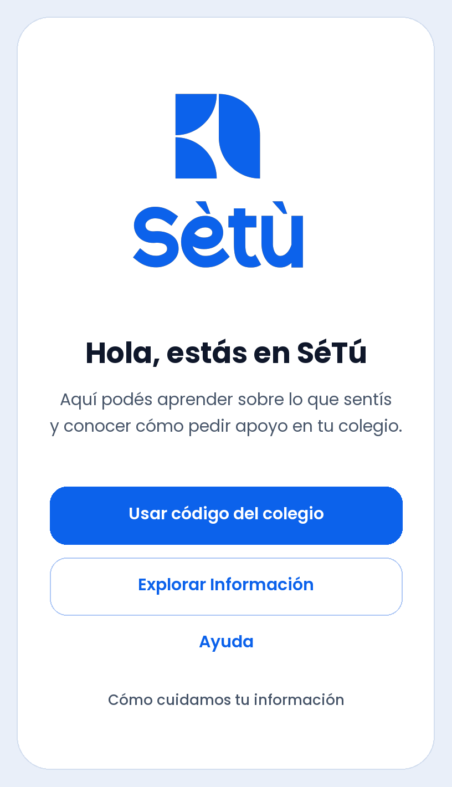

# Plan de arranque y wireframe de bienvenida de SéTú

**12 de noviembre de 2026 · Propuesta para revisión del equipo Bugñuelitos.** Este primer bloque prueba cómo se entiende la entrada estudiantil y cómo se traslada la identidad aprobada a Android. Se revisa como pieza independiente del recorrido integrado previsto para el 17 de noviembre.

## Punto de partida

- **Producto acordado.** Estudiantes de 3.º a 11.º grado, con primera fase en colegios públicos del casco urbano de Managua. La entrada escolar usa el código público del colegio. Información es un destino propio, accesible antes del QR y durante la espera de atención. Ayuda, Información y la solicitud de apoyo cumplen funciones distintas. [Producto](../01-producto.md) · [ADR 0005](../decisiones/0005-alineacion-con-decisiones-del-equipo-drive.md) · [ADR 0009](../decisiones/0009-espacio-informativo-confirmado.md).
- **Base disponible.** La ruta `/` de Flutter abre la pantalla de verificación M1. Ya existen tema Material 3, Poppins empaquetada, `go_router`, ajustes de lectura y protección de pantalla. M1 conserva almacenamiento cifrado y contratos locales del modelo anterior. E01–E11, paneles, backend conectado y red mesh siguen pendientes de implementación. [Código de entrada](../../apps/mobile/lib/app.dart) · [Corte M1](../../apps/mobile/README.md).
- **Fuente visual.** Se revisó el manual de Drive de 32 páginas. La copia local difiere en cinco páginas en la comparación de render y Drive tiene prioridad. El SVG azul versionado coincide con `logos-22.svg` al ignorar el salto de línea final. La copia de trabajo contiene correcciones locales en el tema y el lanzador Android que aplican la paleta de marca. Su revisión y eventual incorporación a Git corresponden al bloque visual de código. [Manual final](https://drive.google.com/file/d/11vE2_hviWBnT79giw6Y8mgofxUckyae6/view) · [Guía de diseño](../06-guia-diseno.md) · [Logo azul](setu-logo-azul.svg).
- **Referente aportado.** La captura de Andrea App muestra una bienvenida con una figura dominante, un saludo breve y bastante espacio en blanco. Para SéTú se propone aprovechar esa jerarquía y dar acceso visible a Información, Ayuda y la entrada escolar. El manual de SéTú define los recursos, la paleta y las reglas de aplicación. [Investigación de referentes](../05-investigacion-y-skills.md).

## Primer wireframe · E01 Bienvenida y privacidad

| Elemento | Propuesta para revisar |
| --- | --- |
| Composición | Una pantalla desplazable. Logotipo azul oficial centrado y con su área de protección. Fondo claro, saludo, descripción de dos frases breves como máximo y tres acciones con jerarquía visible. El arte de mascota o motivos se ubicará fuera del área protegida del logo. |
| Texto inicial | **Hola, estás en SéTú**. «Aquí podés aprender sobre lo que sentís y conocer cómo pedir apoyo en tu colegio». Probar el voseo y la comprensión del texto en primaria y secundaria con la misma estructura inicial. |
| Usar código del colegio | Acción principal → E02. En la prueba abre una vista identificada como demostración, con el propósito del QR y la entrada manual representados. El escáner, la validación y la solicitud de permisos quedan para el bloque de acceso escolar. |
| Explorar Información | Acción secundaria → vista de muestra E10. Explica qué se encontrará en el espacio y permite volver. Se puede abrir directamente desde E01. El catálogo, lector E11 y distribución de contenido se aprueban como bloque propio. |
| Ayuda | Acceso visible → vista de muestra E09 con retorno a E01. Los contactos se incorporan cuando estén verificados por territorio, fecha, fuente y responsable. |
| Cómo cuidamos tu información | Abre un panel legible con cierre y retorno a E01. Texto para revisar con Psicología. «Si pedís apoyo, solo vos y el equipo de escucha asignado pueden leer tu relato y tu chat. El MINED y tu colegio reciben datos limitados para dar seguimiento. Lo que escribás puede revelar quién sos». |

**Identidad.** Usar `#0C62EB` para la acción principal y reservar `#FF0092`, `#FFE000` y `#00C642` para los acentos que apruebe Diseño. Emplear Poppins para texto y controles. Usar el logotipo como arte oficial. Aaron debe confirmar el archivo, la denominación y el papel de la mascota Pulgin/Tapudín, los archivos de rompecabezas, flor de 12 puntas y espiral, y la entrega y licencia de Clayful si se usa como fuente de interfaz. El manual de Drive muestra ambas familias y la guía de interfaz ya propone Poppins para la lectura. [Manual final, pp. 9–22](https://drive.google.com/file/d/11vE2_hviWBnT79giw6Y8mgofxUckyae6/view) · [Guía de diseño](../06-guia-diseno.md).

**Interacción lúdica.** Probar una entrada breve de un motivo oficial, por ejemplo una pieza de rompecabezas que se acomoda al costado del logotipo. El logo y las acciones están disponibles desde el primer cuadro. Duración propuesta de 350 ms, una vez por apertura, con motivo estático si Android pide reducir el movimiento. El retorno desde los destinos conserva la pantalla sin repetir la secuencia. La interacción usa movimiento y respuesta visual. Pedir apoyo y consultar recursos quedan libres de puntos, rachas, retos, premios y bloqueos por progreso.

**Validación por edad.** Usar tareas ficticias en revisión. En primaria, comprobar si se entiende qué hace la app y cómo encontrar Información sin el código. En secundaria, añadir si se distingue Ayuda de la entrada escolar y si se entiende quién podría leer un relato. Pedir que expliquen con sus palabras qué esperan que ocurra al tocar cada opción. Registrar confusiones de etiquetas o recorrido, sin relatos personales. Revisar la redacción con Psicología y la aplicación de marca con Diseño.

## Primera integración propuesta en Flutter/Dart

1. **Revisión de diseño.** Confirmar el formulario, maquetar E01 en Figma o en el formato del diseñador y revisar a 360 dp y con texto ampliado. Cerrar archivos, variante, protección del logo, colores, orden de lectura, estados y textos antes de programar.
2. **Ruta de prueba.** Reutilizar `CureandoTheme`, Poppins y `go_router`. Probar E01 y sus tres destinos locales con una entrada habilitada para la compilación de prueba. La prueba de bienvenida debe poder abrirse en modo avión e independientemente del estado del almacén anterior. El arranque normal sigue llevando a la pantalla M1 durante esta revisión. Aplicar el logo oficial como activo local y usar widgets nativos para disposición y semántica. [Tema](../../apps/mobile/lib/shared/theme/app_theme.dart) · [Router actual](../../apps/mobile/lib/app.dart).
3. **Movimiento.** Agregar la transición después de validar la composición estática. Probar una animación implícita con `TweenAnimationBuilder` y consultar `MediaQuery.disableAnimationsOf` para la variante estática. Usar los recursos de marca locales. La propuesta usa el SDK y las dependencias que ya tiene M1. [Animación en Flutter](https://api.flutter.dev/flutter/widgets/TweenAnimationBuilder-class.html) · [Preferencia de movimiento](https://api.flutter.dev/flutter/widgets/MediaQuery/disableAnimationsOf.html).
4. **Aceptación.** Ejecutar `flutter analyze` y `flutter test`. Añadir pruebas de navegación y retorno, accesibilidad y movimiento reducido para E01. En Android verificar ancho pequeño, texto al 200 %, TalkBack, contraste de texto de 4.5:1 como mínimo para cuerpo y objetivos táctiles de 48 dp. Verificar entrada en modo avión, acciones operables durante el movimiento y apertura de los destinos de muestra sin pedir permisos ni registrar datos. Preparar captura o video ficticio y APK de prueba para revisión del equipo.

**Evidencia de partida.** En la copia local del 12 de noviembre se comprobó Flutter 3.44.5 / Dart 3.12.2, `flutter analyze --no-pub` sin incidencias y 18 pruebas existentes aprobadas con `flutter test --no-pub`. Son comprobaciones de M1 con el tema local. Para E01 aún se requiere implementación, prueba física y aceptación de marca y comprensión.

## Ruta del proyecto y cortes para el 17 de noviembre

| Orden | Bloque y criterio de avance | Dependencia o revisión |
| --- | --- | --- |
| 1 | **12–13 nov, propuesto.** Revisar E01 y, si se aprueba, integrar composición y navegación local. Incorporar el movimiento después de revisar la versión estática. | Diseño confirma activos, Psicología revisa textos y el responsable técnico confirma el corte. La bienvenida y la viabilidad de proximidad pueden avanzar en paralelo con aprobaciones propias. |
| 2 | **Viabilidad offline.** Experimento A → B → puente con tres teléfonos y un sobre ficticio, sin contacto directo entre emisor y puente. Demostrar custodia, alcance y recuperación tras un corte. | Antes de probar, aprobar tecnología, permisos y alcance del experimento. Para integrar, cerrar destinatarios/claves, configuración escolar del primer ingreso sin internet y receptor local. |
| 3 | **Contratos y recorrido conectado.** Aprobar E02–E07, acceso privado por caso, alta de personal, recepción idempotente y proyecciones separadas. Verificar un caso ficticio del estudiante al MINED y dirección, con separación del relato/chat asignado a escucha. | Supabase/PostgreSQL es el backend objetivo. Cliente web y RLS por aprobar. Integración con dos colegios y dos estudiantes del mismo centro. Probar transiciones humanas y reintentos. |
| 4 | **Información E10/E11.** Validar entrada sin QR y entrada durante la espera con retorno al mismo estado. Preparar muestra editorial ficticia, accesible e identificada. | Catálogo, derechos, fuente, territorio, revisión profesional, vigencia, textos alternativos y disponibilidad offline real. Puede avanzar en paralelo al transporte. |
| 5 | **Integración offline.** Cola cifrada, recepción local diferenciada de central, sincronización del puente y acuses. Verificar reinicio y rutas duplicadas. | Evidencia de saltos físicos, claves y destinatarios aprobados, autorización y pruebas de reintento sin duplicar casos. |
| 6 | **16 nov, corte propuesto.** Ensayar APK y guion con un caso ficticio. Registrar en el guion qué tramos se comprobaron en dispositivo y marcar cualquier tramo simulado. **17 nov:** presentación según la organización. | Objetivo del equipo: caso entre las tres superficies, tramo mesh y recorrido de Información. Si falta evidencia, el equipo debe decidir qué mostrará. La guía local indica pitch en vivo y tiempos operativos de 3 min de pitch, 2 min de demo y hasta 1 min de preguntas, sujetos a confirmación. El Resumen de Drive usa «Video Pitch». |

Responsables propuestos para revisar el arranque: Aaron, activos y experiencia visual. María Cecilia, comprensión y privacidad. José Alfredo, Flutter, accesibilidad y evidencia técnica. James, priorización y decisiones de alcance. Andrea y Samantha, revisión de cómo se explica y demuestra el recorrido. La organización confirma el formato del pitch. [Plan de decisiones](../04-plan.md) · [Arquitectura](../02-arquitectura.md) · [Mesh](../10-flujo-datos-y-red-mesh.md) · [Protección](../03-proteccion-y-operacion.md) · [Guía de evaluación](<../../Guía Prototipado y Presentación UAM - UNICEF 2026.docx>) · [Resumen del equipo](https://docs.google.com/document/d/1aKKx9jfSYpSilB3DdTapQAnF8TMX6NkWiBDbxQoIf4g/edit).

## Formulario de arranque para responder en equipo

Marquen una opción por fila. Las recomendaciones son decisiones propuestas. El formulario se puede responder en el chat con `1A, 2A, 3A, 4A, 5A` y los datos de revisión. La fila 5 recoge la aprobación explícita para implementar el bloque de bienvenida.

| Nº | Decisión | Opciones |
| --- | --- | --- |
| 1 | **Arte inicial.** ¿Con qué protagonista validamos la bienvenida? | **A.** Logo oficial y motivo entregado por Aaron. **B.** Mascota oficial como protagonista, con el logo separado, cuando Aaron confirme archivo y nombre. |
| 2 | **Estructura.** ¿Qué se prueba primero? | **A.** Una pantalla con privacidad en panel y tres destinos visibles. **B.** Una pantalla con una explicación breve de privacidad integrada, conservando los tres destinos accesibles. |
| 3 | **Movimiento.** ¿Qué se prepara para la primera revisión? | **A.** Composición estática y después un solo movimiento breve de un motivo. **B.** Composición estática para validar antes de decidir si se anima. |
| 4 | **Arranque Android.** ¿Cómo se abre E01 para revisar? | **A.** Como entrada de compilación de prueba, con destinos de muestra y retorno. **B.** Solo validar el wireframe con el equipo en esta ronda. |
| 5 | **Aprobación del bloque.** ¿Qué avance autorizás con estas elecciones? | **A.** Apruebo implementar la prueba Flutter/Dart descrita con las opciones elegidas. **B.** Solicito ajustes al diseño antes de aprobar. |

**Completar:** enlace a Figma o archivos oficiales que validará Aaron · persona que revisará textos · dispositivo Android disponible para QA · fecha de revisión. Si se elige 4B, responder 5B e indicar qué necesita ver el equipo para aprobar la prueba.

**GitHub.** Guardar primero la propuesta y el wireframe. Con la aprobación de E01, revisar la corrección local de paleta con su autor antes de incorporarla, y guardar avances verificables en commits pequeños. Secuencia sugerida: composición y rutas, movimiento y accesibilidad, y documentación de la demo. Revisar cada diff y publicar el bloque autorizado en el remoto del proyecto. Mantener fuera de Git APK, documentos privados, datos de prueba personales y cachés.
